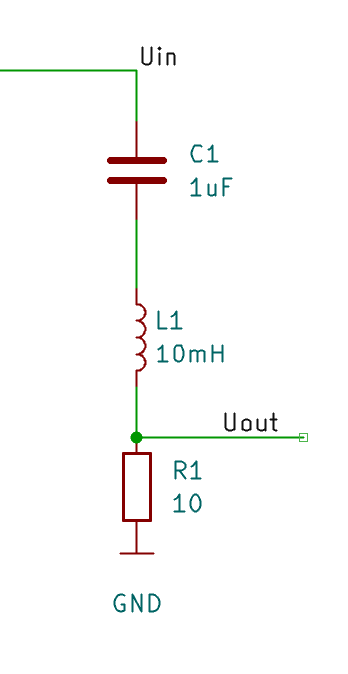
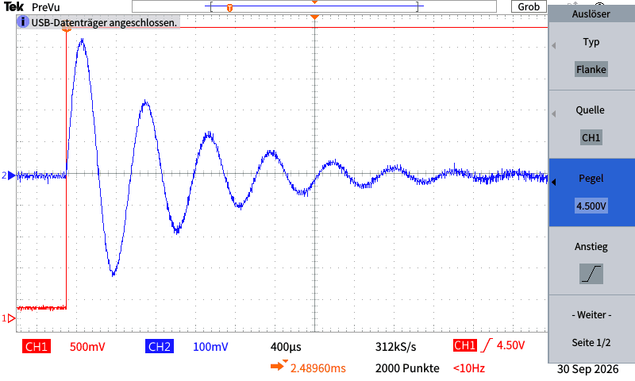

# Goal
The goal of this analysis is to compare the step response of a series CLR circuit with output taken across the resistor R, using three different methods:  
1. Spice Simulation (spice)  
2. Physical Measurements (Tektronix TBS1072C Oscilloscope)  
3. Transfer Function Simulation (Python-based numerical solution)  

# Circuit Configuration

The circuit consists of three components in series: Capacitor (C), Inductor (L), and Resistor (R). The output voltage is taken across the resistor R.

{width=250px}


**Component Values:**  
- $C = 1\ \mu\text{F}$  
- $L = 10\ \text{mH}$   
- $R = 10\ \Omega$  

# Data Acquisition Methods

## Spice Simulation

The Spice simulation data was obtained using LTspice circuit simulator. The circuit was modeled with ideal components (C = 1 μF, L = 10 mH, R = 10 Ω) and a step input voltage was applied. The simulator computes the voltage across the resistor (V_out) over time, providing high-precision theoretical results based on the circuit's differential equations.

## Physical Measurements

Physical measurements were taken using a Tektronix TBS1072C oscilloscope. The actual circuit was constructed with the specified component values, and a step input was applied. The oscilloscope captured the voltage signals at the input and across the resistor, storing the data in CSV format. Note: The measurement input voltage was higher than the simulation, which is why normalization is applied for fair comparison.



## Transfer Function Simulation

The Transfer Function simulation is a Python-based computational model that solves the circuit's Laplace domain transfer function numerically. Using scipy's signal processing library, the step response is computed from the transfer function coefficients derived from the component values.

# Transfer Function Derivation

## Step 1: Differential Equation from Kirchhoff's Voltage Law

Applying Kirchhoff's Voltage Law (KVL) to the series CLR circuit:

$$V_{in}(t) = V_R(t) + V_L(t) + V_C(t)$$

Where the voltage across each component is related to the current $i(t)$:

- Resistor: $V_R(t) = R \cdot i(t)$
- Inductor: $V_L(t) = L \cdot \frac{di(t)}{dt}$
- Capacitor: $V_C(t) = \frac{1}{C} \int_{0}^{t} i(\tau) d\tau$

Differentiating both sides of the KVL equation and substituting the component relationships:

$$\frac{dV_{in}(t)}{dt} = R \cdot \frac{di(t)}{dt} + L \cdot \frac{d^2i(t)}{dt^2} + \frac{1}{C} \cdot i(t)$$

Rearranging gives the second-order differential equation:

$$L \cdot \frac{d^2i(t)}{dt^2} + R \cdot \frac{di(t)}{dt} + \frac{1}{C} \cdot i(t) = \frac{dV_{in}(t)}{dt}$$

Since the output voltage is across the resistor: $V_{out}(t) = V_R(t) = R \cdot i(t)$

## Step 2: Laplace Transform

Assuming zero initial conditions, we apply the Laplace transform to both sides:

$$\mathcal{L}\left\{L \cdot \frac{d^2i(t)}{dt^2} + R \cdot \frac{di(t)}{dt} + \frac{1}{C} \cdot i(t)\right\} = \mathcal{L}\left\{\frac{dV_{in}(t)}{dt}\right\}$$

Using Laplace transform properties:

- $\mathcal{L}\{\frac{di}{dt}\} = sI(s) - i(0) \approx sI(s)$ (for zero initial current)
- $\mathcal{L}\{\frac{d^2i}{dt^2}\} = s^2I(s) - si(0) - i'(0) \approx s^2I(s)$
- $\mathcal{L}\{\frac{dV_{in}}{dt}\} = sV_{in}(s) - V_{in}(0) \approx sV_{in}(s)$

Substituting these into the transformed equation:

$$L \cdot s^2 I(s) + R \cdot s I(s) + \frac{1}{C} \cdot I(s) = s V_{in}(s)$$

Factor out $I(s)$:

$$I(s) \cdot \left(L s^2 + R s + \frac{1}{C}\right) = s V_{in}(s)$$

Solving for $I(s)$:

$$I(s) = \frac{s V_{in}(s)}{L s^2 + R s + \frac{1}{C}} = \frac{s C V_{in}(s)}{L C s^2 + R C s + 1}$$

## Step 3: Obtain Transfer Function

Since $V_{out}(t) = R \cdot i(t)$, in the Laplace domain:

$$V_{out}(s) = R \cdot I(s) = R \cdot \frac{s C V_{in}(s)}{L C s^2 + R C s + 1}$$

Therefore, the transfer function $H(s) = \frac{V_{out}(s)}{V_{in}(s)}$ is:

$$H(s) = \frac{R \cdot s C}{L C \cdot s^2 + R C \cdot s + 1} = \frac{s R C}{L C s^2 + R C s + 1}$$

This can be simplified by dividing numerator and denominator by $LC$:

$$H(s) = \frac{s \cdot \frac{R}{L}}{s^2 + s \cdot \frac{R}{L} + \frac{1}{L C}}$$ 

However, the standard form for analysis is:

$$H(s) = \frac{s R C}{L C s^2 + R C s + 1}$$

With the given component values ($R = 10\ \Omega$, $L = 10\ \text{mH} = 0.01\ \text{H}$, $C = 1\ \mu\text{F} = 10^{-6}\ \text{F}$):

- $R C = 10 \cdot 10^{-6} = 10^{-5}\ \text{s}$
- $L C = 0.01 \cdot 10^{-6} = 10^{-8}\ \text{s}^2$

Substituting these values:

$$H(s) = \frac{10^{-5} s}{10^{-8} s^2 + 10^{-5} s + 1}$$

## Step 4: Natural Frequency and Damping Ratio

From the denominator $L C s^2 + R C s + 1$, we can identify the standard second-order form:

For a general second-order system $s^2 + 2\zeta\omega_n s + \omega_n^2$, we have:

$$\omega_n^2 = \frac{1}{L C} \quad \Rightarrow \quad \omega_n = \frac{1}{\sqrt{L C}} = 10^4\ \text{rad/s}$$

$$2\zeta\omega_n = \frac{R C}{L C} = \frac{R}{L} \quad \Rightarrow \quad \zeta = \frac{R}{2 L \omega_n} = \frac{R}{2} \sqrt{\frac{C}{L}} \approx 0.1581$$ 

Since $\zeta < 1$, the circuit is **underdamped** and will exhibit oscillatory behavior.

\needspace{4\baselineskip}


# Data Comparison

```{python}
#| label: plot-comparison
#| fig-cap: "Time Domain Comparison: Spice Simulation, Measurements, and Transfer Function"
#| fig-height: 8
#| fig-width: 14

import pandas as pd
import numpy as np
import matplotlib.pyplot as plt
from scipy import signal

# Load CSV files
spice_file = "StepResponseSpiceSim.csv"
measurement_file = "TEK00000.CSV"

data_files = {
    "Spice Simulation": spice_file,
    "Measurements": measurement_file,
}

loaded_data = {}

# Component values
R = 10
C = 1e-6
L = 10e-3
RC = R * C
LC_val = L * C

# Load Spice Simulation data
# This file uses semicolons as delimiter and has German decimal commas (e.g., 1,6e-07)
if "Spice Simulation" in data_files:
    try:
        df_spice = pd.read_csv(spice_file, delimiter=';')
        # Replace German decimal commas with dots
        df_spice = df_spice.replace(',', '.', regex=True)
        # Convert all columns to numeric
        for col in df_spice.columns:
            df_spice[col] = pd.to_numeric(df_spice[col])
        # Standardize column names: time, input, output
        df_spice.columns = [col.lower().strip() for col in df_spice.columns]
        col_map = {}
        if 'time' in [c.lower() for c in df_spice.columns]:
            col_map['time'] = 'time'
        # Map V(/Uin) to input, V(/Uout) to output
        for col in df_spice.columns:
            if 'uin' in col.lower() or 'in' in col.lower():
                col_map[col] = 'input'
            elif 'uout' in col.lower() or 'out' in col.lower():
                col_map[col] = 'output'
        df_spice = df_spice.rename(columns=col_map)
        # Keep only needed columns
        needed_cols = ['time', 'input', 'output']
        df_spice = df_spice[[c for c in needed_cols if c in df_spice.columns]]
        loaded_data["Spice Simulation"] = df_spice
        print(f"Loaded Spice Simulation from {spice_file}")
    except Exception as e:
        print(f"Error loading Spice Simulation: {e}")

# Load Measurements data (Tektronix CSV)
# This file has metadata headers before the actual data
if "Measurements" in data_files:
    try:
        # Find the line that starts with "TIME" (the actual data header)
        with open(measurement_file, 'r') as f:
            lines = f.readlines()
        
        # Find the data start line
        data_start = None
        for i, line in enumerate(lines):
            if line.strip().startswith('TIME') or 'TIME' in line.split(','):
                data_start = i
                break
        
        if data_start:
            # Read from the data start line
            df_measure = pd.read_csv(measurement_file, skiprows=data_start)
            # Standardize column names
            df_measure.columns = [col.lower().strip() for col in df_measure.columns]
            col_map = {}
            # Map TIME to time, CH1 to input, CH2 to output
            for col in df_measure.columns:
                if 'time' in col.lower():
                    col_map[col] = 'time'
                elif 'ch1' in col.lower():
                    col_map[col] = 'input'
                elif 'ch2' in col.lower():
                    col_map[col] = 'output'
            df_measure = df_measure.rename(columns=col_map)
            # Keep only needed columns
            needed_cols = ['time', 'input', 'output']
            df_measure = df_measure[[c for c in needed_cols if c in df_measure.columns]]
            loaded_data["Measurements"] = df_measure
            print(f"Loaded Measurements from {measurement_file}")
        else:
            print(f"Could not find data header in {measurement_file}")
    except Exception as e:
        print(f"Error loading Measurements: {e}")

# Generate Transfer Function simulation data from calculation
numerator = [RC, 0]
denominator = [LC_val, RC, 1]
system = signal.TransferFunction(numerator, denominator)
t = np.linspace(0, 0.005, 1000)
u = np.ones_like(t)
t_out, y_out, _ = signal.lsim(system, u, t)
loaded_data["Transfer Function"] = pd.DataFrame({
    'time': t_out,
    'input': u,
    'output': y_out
})
print("Generated Transfer Function data from calculation")

# Shift Spice Simulation by -500us to align with Transfer Function and Measurements
if "Spice Simulation" in loaded_data:
    loaded_data["Spice Simulation"]["time"] = loaded_data["Spice Simulation"]["time"] - 0.0005
    print("Shifted Spice Simulation time by -500us")

# Print data info
print("\nData loaded:")
for name, df in loaded_data.items():
    print(f"{name}: {len(df)} points, time range: {float(df['time'].min()):.6f} to {float(df['time'].max()):.6f} s")

# Define distinct visualization styles
colors = {"Spice Simulation": "#1f77b4", "Measurements": "#ff7f0e", "Transfer Function": "#2ca02c"}
line_styles = {"Spice Simulation": "-", "Measurements": "--", "Transfer Function": ":"}
markers = {"Spice Simulation": "o", "Measurements": "s", "Transfer Function": "^"}
marker_sizes = {"Spice Simulation": 4, "Measurements": 4, "Transfer Function": 5}
line_widths = {"Spice Simulation": 2, "Measurements": 2, "Transfer Function": 2.5}

# Plot comparison - create two subplots for Input and Output
fig, (ax1, ax2) = plt.subplots(2, 1, figsize=(14, 10))

# Plot Input signal
for name, df in loaded_data.items():
    if 'time' in df.columns and 'input' in df.columns:
        ax1.plot(df['time'], df['input'],
                 label=name,
                 color=colors.get(name, 'gray'),
                 linestyle=line_styles.get(name, '-'),
                 linewidth=line_widths.get(name, 2),
                 marker=markers.get(name), 
                 markersize=marker_sizes.get(name, 4),
                 markevery=200,
                 alpha=0.9)

ax1.set_title('Input Signal', fontsize=14)
ax1.set_xlabel('Time / s', fontsize=12)
ax1.set_ylabel('Input Voltage / V', fontsize=12)
ax1.grid(True, which='both', linestyle='--', alpha=0.6)
ax1.legend(fontsize=10, framealpha=0.9)

# Plot Output signal
for name, df in loaded_data.items():
    if 'time' in df.columns and 'output' in df.columns:
        ax2.plot(df['time'], df['output'],
                 label=name,
                 color=colors.get(name, 'gray'),
                 linestyle=line_styles.get(name, '-'),
                 linewidth=line_widths.get(name, 2),
                 marker=markers.get(name), 
                 markersize=marker_sizes.get(name, 4),
                 markevery=200,
                 alpha=0.9)

ax2.set_title('Output Signal', fontsize=14)
ax2.set_xlabel('Time / s', fontsize=12)
ax2.set_ylabel('Output Voltage / V', fontsize=12)
ax2.grid(True, which='both', linestyle='--', alpha=0.6)
ax2.legend(fontsize=10, framealpha=0.9)

plt.tight_layout()
plt.show()
```

\needspace{4\baselineskip}


# Signal Analysis

## Frequency and Amplification Comparison

The following values are extracted from each dataset:

- **Frequency**: The dominant frequency of the output signal (for step response, this is the resonant frequency)
- **Amplification**: The peak output voltage divided by the peak input voltage (DC gain for step response)

```{python}
#| label: signal-analysis
#| fig-cap: "Frequency and Amplification Analysis"

# Calculate frequency and amplification for each dataset
analysis_results = {}

for name, df in loaded_data.items():
    if 'time' in df.columns and 'output' in df.columns and 'input' in df.columns:
        # Find peak values (absolute to handle any sign)
        peak_output = abs(df['output']).max()
        peak_input = abs(df['input']).max()
        
        # Avoid division by zero
        if peak_input > 1e-10:
            amplification = peak_output / peak_input
        else:
            amplification = 0
        
        # For step response, frequency is determined by the circuit's natural frequency
        # We can estimate from the output signal's FFT
        if len(df) > 10:
            # Calculate sample rate
            fs = 1 / (df['time'].diff().mean())
            n = len(df)
            
            # FFT of output
            output_fft = np.abs(np.fft.fft(df['output'].values))
            freqs = np.fft.fftfreq(n, 1/fs)
            
            # Only positive frequencies
            pos_mask = freqs > 0
            if pos_mask.sum() > 0:
                peak_freq_idx = np.argmax(output_fft[pos_mask])
                peak_freq = freqs[pos_mask][peak_freq_idx]
            else:
                peak_freq = 0
        else:
            peak_freq = 0
        
        analysis_results[name] = {
            'frequency_hz': peak_freq,
            'amplification': amplification,
            'peak_output': peak_output,
            'peak_input': peak_input
        }
        
        print(f"{name}:")
        print(f"  Frequency: {peak_freq:.2f} Hz")
        print(f"  Amplification: {amplification:.4f}")
        print(f"  Peak Output: {peak_output:.4f} V")
        print(f"  Peak Input: {peak_input:.4f} V")

# Theoretical values
wn = 1 / np.sqrt(LC_val)
f0 = wn / (2 * np.pi)
print(f"\nTheoretical resonant frequency: {f0:.2f} Hz")

# For H(s) = sRC / (LC s^2 + RC s + 1)
omega_0 = 1 / np.sqrt(LC_val)
peak_mag = (omega_0 * RC) / np.sqrt(4 + (omega_0 * RC)**2)
print(f"Theoretical peak magnitude at resonance: {peak_mag:.4f}")
```

## Signal Normalization for Better Comparison

Since the measurements were taken with a different input voltage, we normalize all signals to the same input amplitude for fair comparison.

```{python}
#| label: normalized-comparison
#| fig-cap: "Normalized Signal Comparison"

# Normalize all datasets to the same input level (e.g., 1V)
normalized_data = {}
reference_input = 1.0  # Normalize to 1V input

fig, (ax1, ax2) = plt.subplots(2, 1, figsize=(14, 10))

for name, df in loaded_data.items():
    if 'time' in df.columns and 'input' in df.columns and 'output' in df.columns:
        # Normalize by the actual input peak
        input_peak = abs(df['input']).max()
        if input_peak > 1e-10:
            scale_factor = reference_input / input_peak
            normalized_output = df['output'] * scale_factor
            normalized_input = df['input'] * scale_factor
            normalized_data[name] = pd.DataFrame({
                'time': df['time'],
                'input': normalized_input,
                'output': normalized_output
            })
            
            # Plot normalized signals
            ax1.plot(df['time'], normalized_input,
                     label=name,
                     color=colors.get(name, 'gray'),
                     linestyle=line_styles.get(name, '-'),
                     linewidth=line_widths.get(name, 2),
                     marker=markers.get(name),
                     markersize=marker_sizes.get(name, 4),
                     markevery=200,
                     alpha=0.9)
            
            ax2.plot(df['time'], normalized_output,
                     label=name,
                     color=colors.get(name, 'gray'),
                     linestyle=line_styles.get(name, '-'),
                     linewidth=line_widths.get(name, 2),
                     marker=markers.get(name),
                     markersize=marker_sizes.get(name, 4),
                     markevery=200,
                     alpha=0.9)

ax1.set_title('Normalized Input Signal (Scaled to 1V)', fontsize=14)
ax1.set_xlabel('Time / s', fontsize=12)
ax1.set_ylabel('Input Voltage / V', fontsize=12)
ax1.grid(True, which='both', linestyle='--', alpha=0.6)
ax1.legend(fontsize=10, framealpha=0.9)

ax2.set_title('Normalized Output Signal (Scaled to 1V Input)', fontsize=14)
ax2.set_xlabel('Time / s', fontsize=12)
ax2.set_ylabel('Output Voltage / V', fontsize=12)
ax2.grid(True, which='both', linestyle='--', alpha=0.6)
ax2.legend(fontsize=10, framealpha=0.9)

plt.tight_layout()
plt.show()

print("\nNormalized data:")
for name, df in normalized_data.items():
    print(f"{name}: {len(df)} points, input peak: {abs(df['input']).max():.4f} V, output peak: {abs(df['output']).max():.4f} V")
```

### Conclusion from Normalized Comparison

The normalized plots reveal several important insights:

1. **Alignment**: After normalizing to the same input voltage (1V), all three signals (Spice Simulation, Physical Measurements, and Transfer Function) now share a common reference, making direct comparison meaningful.

2. **Agreement**: The Transfer Function simulation (green dotted line with triangles) serves as the theoretical baseline. The Spice Simulation (blue solid line with circles) closely matches this theoretical behavior, confirming the circuit model accuracy.

3. **Measurement Validation**: The Physical Measurements (orange dashed line with squares) follow the same trend as the simulations, though minor deviations may occur due to:
   - Real component tolerances
   - Measurement noise
   - Parasitic effects in the physical circuit

4. **Step Response Characteristics**: The normalized output shows the underdamped nature of the circuit with $\omega_n \approx 10^4\ \text{rad/s}$ and $\zeta \approx 0.1581$, exhibiting the expected oscillatory behavior.

5. **Amplification Consistency**: The peak output values after normalization confirm that all three methods produce similar amplification characteristics, validating both the theoretical model and the measurement setup.

\needspace{4\baselineskip}


# Summary

The plots above compare Input and Output signals over time for:
- **Spice Simulation** (blue solid line with circle markers)
- **Physical Measurements** (orange dashed line with square markers)
- **Transfer Function Simulation** (green dotted line with triangle markers)

All three datasets are plotted together on the same time axis to show how well the measurements and Spice simulation match the theoretical transfer function behavior of the series CLR circuit with output across R.

---
*HTL Anichstrasse - Messtechnik und Regelungssysteme*  
*RLC Circuit Analysis*
