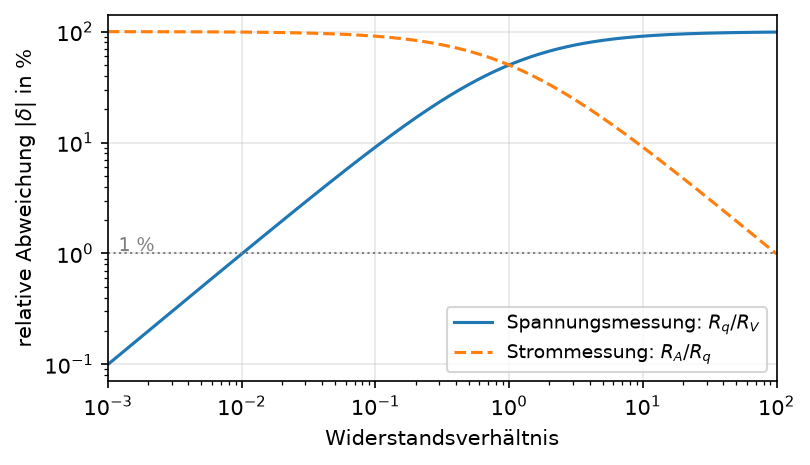

# Strom-, Spannungs- und Widerstandsmessung {#sec-mt-strom-spannung}

## Ideale und reale Messgeräte

| Messgerät | ideal | real |
|---|---|---|
| Voltmeter | $R_V \to \infty$ (stromlos) | endlicher $R_V$ (z. B. 10 M$\Omega$) |
| Amperemeter | $R_A \to 0$ (spannungslos) | kleiner, aber endlicher $R_A$ |

Konsequenz: jedes reale Messgerät entnimmt der Schaltung Energie und
verändert damit die zu messende Größe — eine systematische Messabweichung
 durch Rückwirkung; sie wird berechnet, korrigiert und ihr Restanteil ins
 Unsicherheitsbudget aufgenommen (GUM, @sec-mt-gum).

## Spannungsrichtige und stromrichtige Schaltung

- **Spannungsrichtig:** Voltmeter liegt direkt am Verbraucher. Die Messabweichung rührt
  vom Spannungsteiler aus $R_V$ und Quellenwiderstand $R_q$:

$$U_{mess} = U_q \cdot \frac{R_V}{R_V + R_q}, \qquad
\delta_U = \frac{U_{mess}-U_q}{U_q} = -\frac{R_q}{R_V + R_q} \approx -\frac{R_q}{R_V}$$

- **Stromrichtig:** Amperemeter liegt in Reihe mit dem Verbraucher; sein
  Widerstand verringert den Strom:

$$I_{mess} = \frac{U_q}{R_q + R_A}, \qquad
\delta_I = -\frac{R_A}{R_q + R_A} \approx -\frac{R_A}{R_q}$$

- Faustregel: $R_V \gg R_q$ bzw. $R_A \ll R_q$ — mindestens zwei Zehnerpotenzen
  Abstand, damit die Rückwirkungsabweichung unter 1 % bleibt.

{#fig-rueckwirkung}

> **Platzhalter — Schaltbild:** übersichtliches Schaltbild mit Quelle $U_q$
> (mit $R_q$), Verbraucher $R$, Voltmeter parallel zum Verbraucher
> (spannungsrichtig) und Amperemeter in Reihe (stromrichtig), jeweils mit
> eingezeichnetem Innenwiderstand.

, via [Wikimedia Commons](https://commons.wikimedia.org/wiki/File:Electric_circuit_with_voltmeter_and_ammeter.JPG))](images/Electric_circuit_with_voltmeter_and_ammeter.JPG){#fig-voltmeter-ammeter}

**Rechenbeispiel.** Quelle mit $R_q = 10\,\mathrm{k\Omega}$, Voltmeter mit
$R_V = 1\,\mathrm{M\Omega}$:

$$\delta_U \approx -\frac{10\,\mathrm{k\Omega}}{1\,\mathrm{M\Omega}} = -1\,\%$$

Mit $R_V = 10\,\mathrm{M\Omega}$ (typisches DMM) sinkt die Abweichung auf $-0{,}1\,\%$.

## Widerstandsmessung

**Amperemeter-Voltmeter-Methode.** Aus $R = U/I$ mit zwei Schaltvarianten:

- Spannungsrichtig (Amperemeter misst auch Voltmeterstrom) — geeignet
  für kleine Widerstände ($R \ll R_V$):

$$R_{mess} = \frac{U}{I} = \frac{R\cdot R_V}{R + R_V} \approx R \quad \text{für } R \ll R_V$$

- Stromrichtig (Voltmeter misst auch Amperemeterspannung) — geeignet
  für große Widerstände ($R \gg R_A$):

$$R_{mess} = R + R_A \approx R \quad \text{für } R \gg R_A$$

**Direkte Widerstandsmessung mit dem Multimeter.**

- Das DMM speist einen konstanten Messstrom und misst den Spannungsabfall:
  $R = U_{ab}/I_{mess}$.
- **Vierleitertechnik (4-Wire):** Messstrom fließt über eigene Zuleitungen,
  die Spannung wird über stromlose Sensingleitungen abgegriffen — die
  Zuleitungs- und Kontaktwiderstände fallen aus dem Ergebnis heraus.
  Standard bei kleinen Widerständen (Shunts).
- Hinweis: Widerstandsmessung grundsätzlich nur an spannungsfreien,
  stromlosen Schaltungen.
