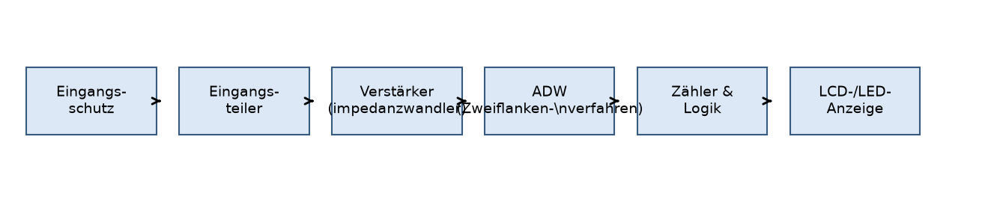

# Digitale Multimeter {#sec-mt-dmm}

## Messwerke — die Grundlage der analogen Anzeige

- Klassisches Messgerät der Elektromesstechnik: **Drehspulmesswerk**. Lorentzkraft
  auf stromdurchflossene Spule im Permanentfeld erzeugt ein Drehmoment; die
  Spiralfeder stellt das Gleichgewicht her:

$$M = c\cdot I = k\cdot\alpha \quad\Rightarrow\quad \alpha = \frac{c}{k}\cdot I
\quad\text{(linearer Skalenverlauf)}$$

- Mittelwertmesswerk: reagiert auf den arithmetischen Mittelwert — daher
  DC-fähig; mit vorgeschaltetem Gleichrichter als Gleichrichter-Messwerk
  auch für AC (skaliert den Gleichrichtwert).
- Dreheisenmesswerk: eisenbewegtes Messwerk, auch für AC direkt geeignet
  (quadratische Kennlinie → ungleichmäßige Skala).

, via [Wikimedia Commons](https://commons.wikimedia.org/wiki/File:Moving_coil_instrument_principle.png))](images/Moving_coil_instrument_principle.png){#fig-drehspul width=320px}

## Blockschaltbild des digitalen Multimeters

Signalfpfad des Multimeters vom Eingangsbereich bis zur Anzeige:

{#fig-dmm-block}

- **Eingangsschutz:** Sicherungen, Varistoren, Klemmschaltung gegen Überlastung.
- **Eingangsteiler:** hochohmige Widerstandskette (z. B. 10 M$\Omega$-Eingang)
  legt das Signal auf den Arbeitsbereich des Verstärkers.
- **Verstärker:** Impedanzwandler/auto-zero-Verstärker entkoppelt Teiler und ADW.
- **ADW:** im DMM überwiegend **Zweiflankenverfahren (Dual Slope)** — integriert
  erst über feste Zeit $T_1$ gegen $U_x$, dann gegen $U_{ref}$ bis zum Nulldurchgang:

$$U_x = U_{ref}\cdot\frac{T_2}{T_1}$$

  Die Integration über eine volle Netzperiode unterdrückt Brummen; die
  Genauigkeit hängt allein von $U_{ref}$ und dem Takt ab.
- **Zähler & Anzeige:** Taktzähler während $T_2$ → Messwert in counts,
  Dekodierung auf die 3½-/4½-stellige Anzeige.

> **Platzhalter — Zweiflankenverlauf:** Diagramm der Integratorspannung beim
> Zweiflankenverfahren (linearer Anstieg während $T_1$, linearer Abfall bis
> null während $T_2$), um die Zeitverhältnis-Gleichung anschaulich zu machen.

)](images/Digitalmultimeter.jpg){#fig-dmm width=180px}

## Kenngrößen des DMM

- **Stellenzahl und counts:** $3\tfrac{1}{2}$-stellig → 1999 counts;
  Auflösung $Q = \text{Endwert}/1999$.
- **Genauigkeitsangabe** des Datenblatts:

$$\Delta U = \pm(a\%\ \mathrm{v.\,M.} + n\ \mathrm{digits})$$

- **True-RMS:** echte Effektivwertbildung (Leistungsmessung proportional zu
  $\overline{u^2}$) statt bloßer Skalierung des Gleichrichtwerts — das
  Ergebnis wird von der Signalform unabhängig.
- AC-Messbereiche sind kapazitiv gekoppelt (Mittelwert-Messwerke skalieren
  den Gleichrichtwert auf Sinus um). Bedienung: bei unbekannter Größe im
  größten Messbereich beginnen.
