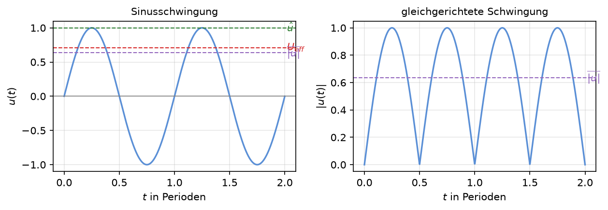

# Elektrische Kennwerte periodischer Signale {#sec-mt-kennwerte}

Zeitabhängige Größen $u(t)$, $i(t)$ beschreibt man über Kennwerte, die eine
ganze Periode $T$ zusammenfassen — die Mittelwerte.

## Definitionen

- **Arithmetischer Mittelwert (Gleichwert):**

$$\bar{u} = \frac{1}{T}\int_0^T u(t)\,dt$$

- **Gleichrichtwert:** Mittelwert des Betrags (Grundlage analoger
  Gleichrichter-Messwerke):

$$\overline{|u|} = \frac{1}{T}\int_0^T |u(t)|\,dt$$

- **Effektivwert (RMS):** äquivalenter DC-Wert, der in einem Widerstand
  dieselbe Leistung umsetzt:

$$U = \sqrt{\frac{1}{T}\int_0^T u^2(t)\,dt}, \qquad
P = \frac{U^2}{R}$$

- **Scheitelwert** $\hat{u}$: Maximalbetrag; **Spitze-Spitze-Wert** $u_{ss}$.

{#fig-kennwerte}

## Form- und Scheitelfaktor

$$k_f = \frac{U}{\overline{|u|}}, \qquad k_s = \frac{\hat{u}}{U}$$

| Signal | $\hat{u}$ | $U_{eff}$ | $\overline{|u|}$ | $k_s$ |
|---|---|---|---|---|
| Sinus | $\hat{u}$ | $\hat{u}/\sqrt{2}\approx 0{,}707\hat{u}$ | $\frac{2}{\pi}\hat{u}\approx 0{,}637\hat{u}$ | $1{,}414$ |
| Dreieck | $\hat{u}$ | $\hat{u}/\sqrt{3}$ | $\hat{u}/2$ | $1{,}732$ |
| Rechteck | $\hat{u}$ | $\hat{u}$ | $\hat{u}$ | $1$ |

- Sinus: $k_f = \frac{\pi}{2\sqrt{2}} \approx 1{,}11$ — Gleichrichter-Messwerke
  skalieren den Gleichrichtwert daher mit dem Faktor 1,11 auf Sinus-RMS hoch.

**Rechenbeispiel.** Netzspannung $\hat{u} = 325\,\mathrm{V}$:
$U_{eff} = 325/\sqrt{2} = 230\,\mathrm{V}$;
Gleichrichtwert $\overline{|u|} = \frac{2}{\pi}\cdot 325 \approx 207\,\mathrm{V}$.

> **Platzhalter — Oszillogramm:** Foto eines Oszilloskopeingangs mit Sinus- und
> Rechtecksignal (gleiche Amplitude), um Effektivwert- und Formfaktor-Unterschiede
> am realen Gerät sichtbar zu machen.

## Grafische Bestimmung

- Flächenbetrachtung: $\bar{u} = 0$, wenn Flächen ober- und unterhalb der
  Zeitachse gleich groß sind (z. B. reiner Sinus ohne Offset).
- Effektivwert grafisch: quadrieren, mitteln, Wurzel ziehen — bei einfachen
  Verläufen (Rechteck) direkt ablesbar.
- Gleichgerichtete Darstellung → Mittelwert (= Gleichrichtwert) als
  waagerechte Linie ablesen.
