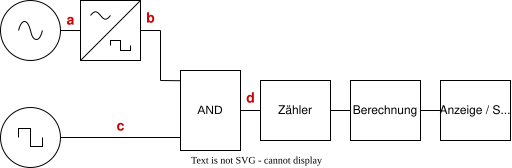

# Frequenz- und Periodenmessung {#sec-mt-frequenz-periode}



**Verwendete Symbole:**

```{python}
#| echo: true
#| code-fold: true
# kapitelweite Symbole (in allen Unterkapiteln gleich)
f_s = MySymbol('f', description='Frequenz', unit=u.hertz)
T_s = MySymbol('T', description='Periodendauer', unit=u.second)
QBookHelpers.print_description([f_s, T_s])
```


## Warum Frequenz messen?

- **Frequenz als Zielgröße:** In der Nachrichtentechnik muss etwa die
  eingestellte Mittenfrequenz eines Sendekanals messtechnisch verifiziert
  werden. Beim 2,4-GHz-WLAN beträgt die Mittenfrequenz von Kanal 1
  $2412\,\mathrm{MHz}$. Eine Frequenzmessung prüft diese Mittenfrequenz; für
  Bandbreite und Spektrumsmaske ist dagegen eine Spektrumanalyse erforderlich.
- **Frequenz als Messsignal:** Viele Sensoren wandeln eine physikalische Größe
  direkt in eine Frequenz um. Mit bekanntem Weg oder bekanntem Volumen je
  Periode ergeben sich dann Geschwindigkeit und Durchfluss:

```{python}
#| echo: true
#| code-fold: true
f_s = MySymbol('f', description='Frequenz des Sensorsignals', unit=u.hertz)
s_p = MySymbol('s', description='Weg je Periode (Sensorvertrag)', unit=u.meter)
v_g = MySymbol('v', description='Geschwindigkeit', unit=u.meter/u.second)
n_s = MySymbol('n_1', description='Anzahl der Perioden im Messintervall', )
V_p = MySymbol('V', description='Volumen je Periode', unit=u.liter)
V_g = MySymbol('V_{ges}', description='Gesamtvolumen im Messintervall', unit=u.liter)
Q_f = MySymbol('Q', description='Durchfluss (Volumenstrom)', unit=u.liter/u.second)
QBookHelpers.print_description([s_p, v_g, n_s, V_p, V_g, Q_f])
QBookHelpers.print_equation(Eq(v_g, s_p*f_s), label='eq-geschwindigkeit-frequenz')
QBookHelpers.print_equation(Eq(V_g, n_s*V_p), label='eq-volumen-frequenz')
QBookHelpers.print_equation(Eq(Q_f, V_p*f_s), label='eq-durchfluss-frequenz')
```

- Wegen der einfachen Digitalisierung (Zählen statt Amplitudenmessung) sind
  Frequenzsignale störungsarm über lange Leitungen übertragbar.

## Periodische Signale

Ein Signal heißt periodisch, wenn es sich nach der Periodendauer $T$ wiederholt.
Das muss kein Sinussignal sein — Rechteck- oder Sägezahnsignale sind ebenfalls
periodisch.

```{python}
#| echo: true
#| code-fold: true
#| label: fig-sinus
#| fig-cap: 'Sinussignal mit drei Perioden; die Periodendauer T ist über eine volle Periode markiert.'
fig, ax = plt.subplots()

t = np.arange(0, 3, 0.01)
y = np.sin(2*np.pi*1*t)

ax.plot(t, y)
ax.grid(True)
ax.set_xlabel('Zeit in Sekunden')
ax.set_ylabel('Amplitude')

# Periodenbereiche hinterlegen
ax.axvspan(0, 1, color='green', alpha=0.1)
ax.text(0.15, 1.25, 'Erste Periode', fontsize=9)
ax.axvspan(1, 2, color='blue', alpha=0.1)
ax.text(1.15, 1.25, 'Zweite Periode', fontsize=9)
ax.text(2.15, 1.25, 'Dritte Periode', fontsize=9)

# eine volle Periode als Pfeil einzeichnen
ax.arrow(1, -0.6, 1, 0, length_includes_head=True, head_width=0.08)
ax.arrow(2, -0.6, -1, 0, length_includes_head=True, head_width=0.08)
ax.text(1.5, -0.45, 'Periodendauer $T$', ha='center')

ax.set_ylim(-1.5, 1.5)
plt.show()
```

Die Einheit der Frequenz ist das
[Hertz (Hz)](https://de.wikipedia.org/wiki/Hertz_%28Einheit%29) — in
SI-Basiseinheiten der Kehrwert der Zeit, $\mathrm{Hz = 1/s}$. Der
Zusammenhang zwischen Frequenz und Periodendauer folgt direkt daraus:

```{python}
#| echo: true
#| code-fold: true
T_p = MySymbol('T', description='Periodendauer', unit=u.second)
f_p = MySymbol('f', description='Frequenz', unit=u.hertz)
QBookHelpers.print_equation(Eq(f_p, 1/T_p), label='eq-frequenz-periode')
```

## Messaufbau

Periodendauer und Frequenz lassen sich mit demselben Messaufbau bestimmen:
Zähler plus Takt mit bekannter Periodendauer ([@schrufer2022], Kapitel
„Digitale Grundschaltungen; Zeit- und Frequenzmesstechnik"). Die Signalquelle
steht symbolisch für das zu messende Signal — es muss periodisch sein, aber
nicht sinusförmig.

{#fig-block-freq}

- Der **Komparator** formt das Messsignal (a) in ein Rechtecksignal (b) um.
  Bei jeder Periode entsteht genau eine steigende Flanke, die als Zählimpuls
  ausgewertet werden kann.
- Der **Takt** (c) liefert Impulse mit bekannter Periodendauer $T_{q}$.
- Das **UND-Glied** (d) verbindet beide Signale: Welches Signal das Tor
  öffnet und welches durchkommt, unterscheidet die zwei Messverfahren:
  - Öffnet der **Takt** das Tor für eine feste Torzeit, kommen die Impulse
    des Messsignals durch → **Frequenzmessung**.
  - Öffnet das **Messsignal** (b) das Tor für eine Periode, kommen die
    Taktimpulse (c) durch → **Periodendauermessung**.
- Der **Zähler** liefert je nach Betriebsart die Anzahl $N$ der
  Signalperioden bzw. der Taktimpulse.

```{python}
#| echo: true
#| code-fold: true
#| label: fig-komparator
#| fig-cap: 'Messsignal am Punkt a (Sinus) und Ausgang des Komparators am Punkt b (Rechteck) — ein Impuls je Periode.'
fN = 1      # Frequenz in Hz
nN = 2      # Anzahl der Perioden
phiN = np.pi/4  # Phasenverschiebung in Radiant
TN = 1/fN   # Periodendauer
omega = 2*np.pi*fN  # Kreisfrequenz

tN = np.arange(0, nN*TN, TN/1000)
yN = np.sin(omega*tN + phiN)

plt.plot(tN, yN, '-k', label='a (Messsignal)')
plt.plot(tN, 0.5 + 1/2*signal.square(2*np.pi*fN*tN + phiN), '--g', label='b (Komparatorausgang)')
plt.grid()
plt.ylim(-1.2, 1.6)
plt.xlabel('Zeit in s')
plt.ylabel('Amplitude')
plt.legend(loc='upper center', ncol=2, fontsize=9)
plt.show()
```

Am UND-Glied zeigt sich der Rollentausch beider Betriebsarten im direkten
Zeitablauf — dieselbe Hardware, aber die Signale tauschen ihre Aufgaben:
einmal steuert der Takt das Tor (Frequenzmessung), einmal das Messsignal
(Periodendauermessung — im Beispiel unten kommen $N_{q} = 8$ Taktimpulse
je Periode durch):

```{python}
#| echo: true
#| code-fold: true
#| label: fig-rollentausch
#| fig-cap: 'Der Rollentausch im Zeitablauf: oben öffnet der Takt das Tor für die Torzeit Tg und der Zähler zählt Signalimpulse (N = 3); unten öffnet das Messsignal das Tor für genau eine Periode und der Zähler zählt Taktimpulse (Nq = 8).'
fSig_r = 4       # Frequenz des Messsignals in Hz
fTakt_r = 32     # Taktfrequenz in Hz
Tg_r = 0.75      # Torzeit in s (Frequenzmessung)

t_r = np.arange(0, 1.05, 1/(100*fTakt_r))
sig_b_r = 0.5 + 0.5*signal.square(2*np.pi*fSig_r*t_r)    # Komparatorausgang
sig_c_r = 0.5 + 0.5*signal.square(2*np.pi*fTakt_r*t_r)   # Takt

tor_f_r = np.where(t_r < Tg_r, 1.0, 0.0)    # Tor: vom Takt abgeleitet, Laenge Tg
imp_f_r = tor_f_r*sig_b_r                   # Impulse der Frequenzmessung
tor_p_r = np.where((t_r >= 0.25) & (t_r < 0.25 + 1/fSig_r), 1.0, 0.0)
imp_p_r = tor_p_r*sig_c_r                   # Impulse der Periodendauermessung

def count_impulses(imp):
    n = int(imp[0] > 0.5)
    n += int(np.sum((imp[:-1] < 0.5) & (imp[1:] > 0.5)))
    return n

n_f_r = count_impulses(imp_f_r)
n_q_r = count_impulses(imp_p_r)

fig, axes = plt.subplots(6, 1, figsize=(8, 7), sharex=True,
                         gridspec_kw={'hspace': 0.55})
reihen = [(tor_f_r, 'Tor', 'tab:green', '--'),
          (sig_b_r, 'Signal (b)', 'tab:blue', '-'),
          (imp_f_r, 'Impulse (d)', 'k', '-'),
          (tor_p_r, 'Tor', 'tab:green', '--'),
          (sig_c_r, 'Takt (c)', 'tab:blue', '-'),
          (imp_p_r, 'Impulse (d)', 'k', '-')]
for ax, (s, lab, col, ls) in zip(axes, reihen):
    ax.plot(t_r, s, color=col, ls=ls, lw=2)
    ax.set_ylim(-0.25, 1.85)
    ax.set_yticks([])
    ax.set_ylabel(lab, rotation=0, ha='right', va='center', fontsize=9)
    ax.grid(True, axis='x', alpha=0.4)

axes[0].set_title('Frequenzmessung: Takt öffnet das Tor, Zähler zählt Signalimpulse',
                  fontsize=10, pad=8)
axes[3].set_title('Periodendauermessung: Messsignal öffnet das Tor, Zähler zählt Taktimpulse',
                  fontsize=10, pad=8)

axes[0].annotate('', xy=(Tg_r, 1.5), xytext=(0, 1.5),
                 arrowprops=dict(arrowstyle='<->', color='gray'))
axes[0].text(Tg_r/2, 1.62, 'Torzeit $T_{g}$', ha='center', fontsize=9)
axes[3].annotate('', xy=(0.25 + 1/fSig_r, 1.5), xytext=(0.25, 1.5),
                 arrowprops=dict(arrowstyle='<->', color='gray'))
axes[3].text(0.25 + 1/(2*fSig_r), 1.62, 'eine Periode $T$', ha='center', fontsize=9)

axes[2].text(0.87, 0.45, f'$N = {n_f_r}$ Impulse', fontsize=9)
axes[5].text(0.87, 0.45, f'$N_{{q}} = {n_q_r}$ Taktimpulse', fontsize=9)
axes[5].set_xlabel('Zeit in s')

plt.show()
```

Oben wird gezählt, **wie oft** das Signal während einer bekannten Zeit
schwingt; unten, **wie lange** eine unbekannte Periode im Vergleich zum
bekannten Takt dauert. Die Gegenüberstellung:

| | Frequenzmessung | Periodendauermessung |
|---|---|---|
| **Tor öffnet** | Takt → feste Torzeit $T_{g}$ | Messsignal → genau eine Periode $T$ |
| **Zähler zählt** | $N$ Signalimpulse | $N_{q}$ Taktimpulse |
| **Bekannte Größe** | Torzeit $T_{g}$ | Taktperiode $T_{q}$ |
| **Berechnung** | $f = N/T_{g}$ | $T = N_{q} \cdot T_{q}$ |
| **Unsicherheit** | $\pm 1$ Signalimpuls | $\pm 1$ Taktimpuls |

Der Zählstand ist in beiden Fällen $\pm 1$ unsicher, weil sich Toröffnung und
gezählte Impulse nicht synchronisieren lassen: Die Randimpulse fallen je nach
zufälliger Phase hinein oder nicht (@sec-mt-frequenzmessung,
@sec-mt-periodenmessung).

## Frequenzmessung {#sec-mt-frequenzmessung}

Bei der Frequenzmessung zählt der Zähler die Impulse des Messsignals innerhalb
der Torzeit $T_{g}$ (Öffnungsdauer des UND-Glieds):

```{python}
#| echo: true
#| code-fold: true
N_f = MySymbol('N', description='Anzahl der Impulse je Torzeit', )
T_g = MySymbol(r'T_{g}', description='Torzeit', unit=u.second)
QBookHelpers.print_description([N_f, T_g])
QBookHelpers.print_equation(Eq(f_p, N_f/T_g), label='eq-frequenzmessung')
```

Mit der Torzeit $T_{g} = 1\,\mathrm{s}$ und einem Messsignal der Frequenz
$f = 1\,\mathrm{kHz}$ ergibt sich:

```{python}
#| echo: true
#| code-fold: true
T_g_v = MySymbol(r'T_{g}', description='Torzeit', unit=u.second, value=1)
QBookHelpers.print_values([T_g_v])
QBookHelpers.print_equation(Eq(N_f, 1000), label='eq-n-frequenzmessung')
```

```{python}
#| echo: true
#| code-fold: true
eq_f = Eq(f_p, N_f/T_g)
eq_f_num = eq_f.subs({N_f: 1000, T_g: 1})
QBookHelpers.print_equation(eq_f_num, label='eq-frequenzmessung-num')
```

- Der Zähler kann nur ganzzahlige Impulse erfassen, und das Tor öffnet und
  schließt unabhängig von der Phase des Messsignals: Der Randimpuls zählt
  gerade noch mit oder gerade nicht mehr — der Zählstand $\pm 1$ Impuls ist
  daher um höchstens einen Impuls unsicher. Bei $N = 1000$ Impulsen
  in $1\,\mathrm{s}$ bedeutet das eine relative Messabweichung von
  $\pm 0{,}1\,\%$ (Quantisierung, Typ-B-Bewertung nach [@jcgm100_2008]).
- Durch Verlängerung der Torzeit sinkt die relative Messabweichung, dafür
  dauert die Messung länger.

## Periodendauermessung {#sec-mt-periodenmessung}

Bei der Periodendauermessung tauscht man die Rollen: Das Messsignal öffnet das
Tor für eine Periode, und der Zähler zählt die Taktimpulse innerhalb dieser
Periode:

```{python}
#| echo: true
#| code-fold: true
T_q = MySymbol(r'T_{q}', description='Periodendauer des Taktsignals', unit=u.second)
f_q = MySymbol(r'f_{q}', description='Frequenz des Taktsignals', unit=u.hertz)
N_q = MySymbol(r'N_{q}', description='Anzahl der Taktimpulse je Signalperiode', )
QBookHelpers.print_description([T_q, f_q, N_q])
QBookHelpers.print_equation(Eq(T_p, N_q*T_q), label='eq-periodenmessung')
```

Mit einer Taktfrequenz von $f_{q} = 1\,\mathrm{MHz}$ und einem Messsignal
$f = 1\,\mathrm{kHz}$ ergibt sich:

```{python}
#| echo: true
#| code-fold: true
T_q_v = MySymbol(r'T_{q}', description='Periodendauer des Taktsignals', unit=u.second,
                 value=1e-6)
QBookHelpers.print_values([T_q_v])
QBookHelpers.print_equation(Eq(N_q, 1000), label='eq-n-periodenmessung')
T_p_v = MySymbol('T', description='Periodendauer des Messsignals', unit=u.second,
                 value=1e-3)
QBookHelpers.print_values([T_p_v])
```

- Der $\pm 1$-Fehler sitzt wieder am Torrand: Das Tor öffnet synchron mit
  einer Signalflanke und schließt mit der nächsten, aber das Zählen der
  Taktimpulse ist nicht taktsynchron — hinter dem Ergebnis steckt
  $T = (N_{q} \pm 1) \cdot T_{q}$.
- Je mehr Taktimpulse $N_{q}$ je Periode gezählt werden, desto geringer die
  relative Messabweichung. Da $N_{q} = f_{q}/f$, wächst $N_{q}$ bei niedrigen
  Frequenzen — die Periodendauermessung ist daher für niedrige Frequenzen
  genauer.

## Zusammenspiel Frequenz/Periode

| Messverfahren | Zähler zählt | Vorteil | Nachteil |
|---|---|---|---|
| Frequenzmessung | Perioden des Messsignals in fester Torzeit | schnell, genau bei hohen Frequenzen | ungenau bei niedrigen Frequenzen ($N$ klein) |
| Periodendauermessung | Taktimpulse je Signalperiode | genau bei niedrigen Frequenzen | lange Messzeit bei niedrigen Frequenzen (je Messwert) |

Die Zählstände beider Verfahren hängen in entgegengesetzter Richtung von der
Messfrequenz ab: $N = f \cdot T_{g}$ wächst mit $f$, während
$N_{q} = f_{q}/f$ schrumpft. Da die relative Zählabweichung näherungsweise
$1/N$ bzw. $1/N_{q}$ beträgt, ergibt sich eine klare Trennung der
Einsatzbereiche:

```{python}
#| echo: true
#| code-fold: true
#| label: fig-fehler-vergleich
#| fig-cap: 'Relative Zählabweichung (maximal ±1 Impuls) über der Messfrequenz (log-log): Bei niedrigen Frequenzen ist die Periodendauermessung genauer, bei hohen die Frequenzmessung. An der Kreuzung liefern beide Verfahren N = 1000 und damit 0,1 %.'
Tg_e = 1       # Torzeit der Frequenzmessung in s
fq_e = 1e6     # Taktfrequenz der Periodendauermessung in Hz

f_e = np.logspace(0, 6, 600)       # Messfrequenz 1 Hz bis 1 MHz
err_freq_e = 1/(f_e*Tg_e)          # Frequenzmessung: 1/N mit N = f·Tg
err_per_e = f_e/fq_e               # Periodenmessung: 1/Nq mit Nq = fq/f
f_star = np.sqrt(fq_e/Tg_e)        # Kreuzung: 1/(f·Tg) = f/fq

fig, ax = plt.subplots()
ax.loglog(f_e, err_freq_e*100,
          label=f'Frequenzmessung, Torzeit $T_{{g}} = {Tg_e:g}\\,\\mathrm{{s}}$')
ax.loglog(f_e, err_per_e*100,
          label=f'Periodendauermessung, Takt $f_{{q}} = {fq_e/1e6:g}\\,\\mathrm{{MHz}}$')
ax.axvline(f_star, color='gray', ls=':')
ax.annotate(f'Kreuzung: $f^{{*}} = {f_star/1e3:g}\\,\\mathrm{{kHz}}$, '
            'beide Verfahren $N = 1000$ (0,1 %)',
            xy=(f_star, 0.1), xytext=(4e2, 0.002),
            arrowprops=dict(arrowstyle='->', color='gray'), fontsize=9)
ax.text(12, 0.5, 'Periodendauermessung\ngenauer', fontsize=9, color='dimgray',
        ha='center', va='center')
ax.text(6e4, 0.02, 'Frequenzmessung\ngenauer', fontsize=9, color='dimgray',
        ha='center', va='center')
ax.set_xlabel('Messfrequenz in Hz')
ax.set_ylabel(r'Relative Zählabweichung in % (maximal $\pm 1$ Impuls)')
ax.set_ylim(1e-4, 1e2)
ax.grid(True, which='both', alpha=0.3)
ax.legend(loc='upper center', fontsize=9)
plt.show()
```

Links der Kreuzung ($f < f^{*}$) zählt die Frequenzmessung nur wenige Impulse
($N$ klein, Fehler groß), während die Periodendauermessung viele Taktimpulse
sammelt — dort ist sie genauer. Rechts der Kreuzung ist es umgekehrt. Die
Kurven schneiden sich bei $N = N_{q}$, also bei
$f^{*} = \sqrt{f_{q}/T_{g}}$; mit $T_{g} = 1\,\mathrm{s}$ und
$f_{q} = 1\,\mathrm{MHz}$ genau bei $1\,\mathrm{kHz}$ — dort liefern beide
Verfahren $N = N_{q} = 1000$ und damit $0{,}1\,\%$, genau die Rechenbeispiele
aus @sec-mt-frequenzmessung und @sec-mt-periodenmessung.

- Eine längere Torzeit $T_{g}$ verschiebt $f^{*}$ nach unten — die
  Frequenzmessung wird auch bei niedrigeren Frequenzen brauchbar, kostet
  aber Messzeit.
- Moderne Frequenzzähler kombinieren beide Betriebsarten („reziprokes
  Zählen"): Bei niedrigen Frequenzen messen sie $T$ und rechnen auf $f$
  zurück — die Betriebsart wählt der Zähler selbst ([@schrufer2022];
  übersichtlich auch im Wikipedia-Artikel
  [Frequenzzähler](https://de.wikipedia.org/wiki/Frequenzz%C3%A4hler)).

> **Platzhalter — Messgerätefoto:** Frequenzzähler/Oszillator-Baugruppe mit
> sichtbarem Taktquarz und Zähler-IC, um den Messaufbau (@fig-block-freq) mit
> realer Schaltungstechnik zu verbinden.

## Simulator: Frequenz- und Periodenmessung {#sec-mt-frequenz-simulator}

Der folgende Simulator bildet den Messaufbau aus @fig-block-freq vollständig
nach: Sinusquelle über den Komparator, Takt, UND-Glied, Zähler und
Berechnung. Er zeigt beide Betriebsarten gleichzeitig und zeigt dazu die
Zeitdiagramme von Tor, Signal und Impulsen.

- Über die Regler verändert man Signalfrequenz, Amplitude und Offset, die
  Komparatorschwelle, die Taktfrequenz und die Torzeit über den
  Teiler $M$.
- **Messung wiederholen** startet die Messung an einer zufälligen Stelle des
  Sinus: Die Zählerstände springen um $\pm 1$ — genau der Quantisierungsfehler
  aus @sec-mt-frequenzmessung und @sec-mt-periodenmessung.
- Die Anzeige vergleicht die relative Auflösung beider Verfahren und nennt
  die Übergangsfrequenz $f_{\ddot{u}} = f_{c}/\sqrt{M}$, ab der die
  Frequenzmessung genauer wird (@fig-fehler-vergleich).
- Wer die Schwelle aus dem Toleranzband des Sinussignals schiebt, sieht,
  dass der Komparator dann gar nicht mehr schaltet — ohne schneidende
  Flanken keine Messung.

<iframe src="../Interactive/Zdhler-Simulator%20Frequenz%20und%20Periode.html"
        style="width:100%; aspect-ratio:1140/1550; min-height:700px; border:0; border-radius:6px; box-shadow:0 1px 4px rgba(0,0,0,.2);"
        title="Zähler-Simulator: Frequenz- und Periodendauermessung"
        loading="lazy"></iframe>
