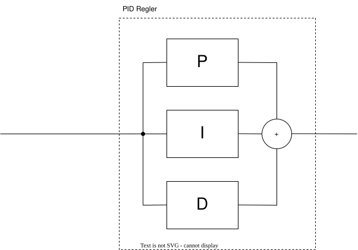

## Stetige Regler 
Für das Verständnis von stetigen Reglern ist es hilfreich, die Regelungstechnik mathematisch zu betrachten, da sich ein Regler gut mit Formeln beschreiben und erklären lässt. In einem eigenen Kapitel wird behandelt, wie Regler praxisnah implementiert werden können.  
Der oben gezeigte Regelkreis @fig-Regelkreis lässt sich mathematisch als Übertragungsfunktion beschreiben. Hier werden ausschließlich LTI-Systeme mit einem Eingang und einem Ausgang betrachtet: SISO (*Single Input, Single Output*). LTI steht für linear und zeitinvariant (*Linear Time-Invariant*). Jeder Block kann mit einer Übertragungsfunktion beschrieben werden; bei einer geeigneten linearen Struktur lässt sich auch die Zusammenschaltung mehrerer Blöcke als Übertragungsfunktion darstellen. Der physikalische Prozess wird dabei als **Regelstrecke** bezeichnet; Blöcke können aber ebenso Regler, Sensoren oder andere Systeme darstellen.

### Der PID Regler
Der PID Regler ist ein stetiger Regler, der sich aus drei Teilen zusammensetzt. Er ist der am häufigsten verwendete stetige Regler in der Regelungstechnik. Wobei der D Anteil in der Praxis oft weggelassen wird.

{#fig-PID1}

#### Voraussetzungen für die klassische PID-Auslegung
Für die klassische Auslegung mit einer Übertragungsfunktion wird eine
hinreichend lineare, zeitinvariante SISO-Strecke angenommen. Nichtlineare
Systeme können oft in der Nähe eines Arbeitspunktes linearisiert werden.
Die drei Anforderungen gelten für dieses Berechnungsmodell.

Ein PID-Regler selbst kann auch digital und damit in abgetasteten Systemen
implementiert werden. Für instabile, stark nichtlineare oder zeitvariante
Strecken sind jedoch zusätzlich geeignete Maßnahmen erforderlich.


### Die Übertragungsfunktion
#### Motivation
Die Übertragungsfunktion beschreibt den Zusammenhang zwischen Ausgang und Eingang.  
Ist die Übertragungsfunktion bekannt, so kann die Strecke und deren Verhalten (der Ausgang) auf verschiedene Eingänge berechnet werden. Dies wird auch Simulation genannt. Für Marketingzwecke könnte die Übertragungsfunktion auch als einfache Form eines "digitalen Zwillings" bezeichnet werden.
Ist die Übertragungsfunktion mathematisch beschrieben, können Regler entworfen und getestet werden, ohne das tatsächliche physikalische Modell benutzen zu müssen. Dies ist speziell sinnvoll, wenn das physikalische System für Testzwecke nicht zur Verfügung steht bzw. nicht für Testzwecke geeignet ist.
Eine Strecke (=physikalisches System) steht z.B. nicht zur Verfügung, wenn: 

* Es sich geographisch woanders befindet  
* Es für die Produktion benötigt wird  
* Es noch nicht gebaut wurde  

Eine Strecke (=physikalisches System) ist nicht geeignet für Testzwecke wenn z.B.:  

* Das System sehr langsam ist (Heizung eines Gebäudes)  
* Ein fehlerhafter Regler großen Schaden anrichten kann  

#### Streckenidentifikation {#sec-Streckenidentifikation}
Als Streckenidentifikation wird der Vorgang beschrieben, von einem physikalischem System das mathematische Modell und die Übertragungsfunktion zu erstellen. Zwei Methoden, wie dieses Ziel erreicht werden kann, werden hier beschrieben.  

* Der mathematische Ansatz, @sec-MathStreckenidentifikation  
* Der messtechnische Ansatz, @sec-MessStreckenidentifikation  


```{python}
#| code-fold: true
E = MySymbol('E',description = 'Eingang')
V = MySymbol('V',description = 'Verarbeitung, die Übertragungsfunktion')
A = MySymbol('A',description = 'Ausgang')
G = MySymbol('G',description = 'Allgemeine Übertragungsfunktion')

Veq = Eq(V,A/E)

display(Markdown(f'$$\n{latex(Veq)}\n$${{#eq-EVA}}'))

QBookHelpers.print_description(Veq.free_symbols)

```

Gängige Bezeichnungen der Übertragungsfunktion der einzelnen Blöcke sind wie folgt.

```{python}
#| code-fold: true
G = MySymbol('G',description = 'Übertragungsfunktion der zu Regelnden Strecke')
R = MySymbol('R',description = 'Übertragungsfunktion des Reglers')
M = MySymbol('M',description = 'Übertragungsfunktion des Sensors')

QBookHelpers.print_description({G,R,M})

```

### Mathematische Streckenidentifikation {#sec-MathStreckenidentifikation}
Aus den physikalischen Zusammenhängen kann die Übertragungsfunktion berechnet werden.
Die komplexe Zeigerdarstellung mit einer festen Frequenz ist für sinusförmige
Dauersignale geeignet. Für zeitveränderliche Signale werden die physikalischen
Gleichungen in Differentialform oder als Zustandsmodell beschrieben.

Um die Mathematik möglichst einfach zu halten, wird in der Regelungstechnik im Laplace Bereich gearbeitet. Dadurch ist es nicht notwendig, die Differenzialgleichung bei physikalischen Systemen, die durch eine Differenzialgleichung beschrieben werden, zu lösen.

Ein Beispiel, wie eine mathematische Streckenidentifikation abläuft, ist in Abschnitt @sec-Laplace zu finden.

### Messtechnische Streckenidentifikation {#sec-MessStreckenidentifikation}
Manche Systeme sind zu komplex, um sie mathematisch zu beschreiben. Bei anderen ist das Innenverhalten nicht bekannt. In diesen Fällen kann die messtechnische Ermittlung eines Modells beziehungsweise einer Übertragungsfunktion herangezogen werden.  
Dabei wird am Eingang der Strecke ein Testsignal aufgeschaltet und der Ausgang gemessen. Aus diesen Messdaten kann die Übertragungsfunktion, ein mathematisches Modell, der Strecke erstellt werden.









