## Von der Sprungantwort zur Übertragungsfunktion {#sec-Sprungantworten}

Dieses Kapitel beschreibt sechzehn Systeme: fünf Grundsysteme, deren
Übertragungsfunktionen direkt aus physikalischen Bauelementewerten
hergeleitet werden, fünf Systeme aus konkreten technischen Anwendungen,
den als Nummer 11 angefügten RLC-Reihenkreis sowie fünf Systeme mit
kombinierten Effekten (Teil IV), in denen mehrere physikalische Effekte
gleichzeitig wirken — eine Nullstelle in der rechten s-Halbebene, ein
Integrierer hinter einer Totzeit, eine differenzierende Nullstelle,
eine doppelte Verzögerung mit Totzeit und Coulomb-Reibung. Die Skripte
`generate_step_responses.py`, `generate_step_responses_applications.py`
und `generate_step_responses_multi_effect.py` bauen jede
Übertragungsfunktion $G(s)$ mit **sympy**, regen sie mit einem
realistischen Eingangssprung an (reale Amplituden wie 5 V, 500 N,
2 L/s — kein normierter 0-auf-1-Sprung), berechnen die Sprungantwort
analytisch als

$$y(t) = \mathcal{L}^{-1}\left\{\frac{G(s)}{s}\right\},$$

und speichern sie als CSV-Datei (`time_s`, `step_response`, 2001
Stützpunkte). Die einzige Ausnahme ist System 16 (Coulomb-Reibung):
Reibung ist nichtlinear und verletzt die Superposition, deshalb wird
dieses System numerisch integriert (RK4 mit Stick-Erkennung). Jedes
System wird in seinem eigenen Zeitfenster abgetastet — etwa 4 bis 5
Zeitkonstanten —, sodass CSV und Plot den Übergangsvorgang dort zeigen,
wo er passiert, und nicht lange Strecken eingeschwungener Werte.
Kurznummerierte Kopien aller sechzehn CSV-Dateien liegen im Ordner
`csv/` (`01.csv` … `16.csv`); die 1-kΩ-Varianten `01_a`, `02_a` und
`11_b` werden in Teil III beschrieben. Die im gesamten Kapitel
verwendeten Standard-Modellklassen — PT1, PT2, Integrierer, Totzeit,
differenzierende und nichtminimalphasige Nullstellen, Totzone — sind
in der folgenden Toolbox zusammengestellt.

## Die Toolbox der Standardglieder

Jede Übertragungsfunktion in diesem Kapitel ist aus einer kleinen Menge
von Standardelementen aufgebaut. Dieser Abschnitt sammelt sie: die
Formel, das Pol-/Nullstellenmuster, die Form der Sprungantwort und die
Systeme, in denen jedes Element vorkommt. Das statische Verhalten wird
immer durch die Gleichspannungsverstärkung $K = G(0)$ festgelegt — der
Endwert eines stabilen Systems ist $y(\infty) = K\cdot u_0$
(Endwertsatz) — deshalb ist die Amplitude $u_0$ des Eingangssprungs in
jedes $G(s)$ dieses Kapitels einbezogen.

### PT1-Glied — Verzögerung 1. Ordnung (ein reeller Pol)

$$G(s) = \frac{K}{\tau s + 1}, \qquad
y(t) = K\left(1 - e^{-t/\tau}\right)$$

- Pol bei $-1/\tau$; die Antwort erreicht 63.2 % des Endwerts bei
  $t = \tau$, 95 % bei $3\tau$ und 99.3 % bei $5\tau$ — daher kommen die
  Abtastfenster von „etwa 4 bis 5 Zeitkonstanten“.
- Erkennbar am Exponentialverlauf *ohne* Wendepunkt: steilster Anstieg
  bei $t = 0$, danach immer langsamer.
- Physikalischer Ursprung: ein Energiespeicher mit einem Verlustpfad
  (RC-Glied, $L/R$, Masse gegen Fahrwiderstand, Behälter mit Ventil).
- Systeme 1, 2, 6, 7 und die Varianten `01_a`, `02_a`.

### PT2-Glied, aperiodisch — zwei reelle Pole in Reihe

$$G(s) = \frac{K}{(\tau_1 s + 1)(\tau_2 s + 1)}, \qquad
y(t) = K\left[1 - \frac{\tau_2\,e^{-t/\tau_2} - \tau_1\,e^{-t/\tau_1}}
{\tau_2 - \tau_1}\right]$$

- Zwei negative reelle Pole; die Antwort ist **s-förmig** mit dem
  Wendepunkt bei
  $t_w = \frac{\tau_1\tau_2}{\tau_2 - \tau_1}\ln\frac{\tau_2}{\tau_1}$.
- Erkennbar am flachen Anfang (der langsame Speicher ist noch nicht
  geladen), gefolgt vom Punkt des steilsten Anstiegs und dem
  einschwingenden Ende — die klassische Kurve thermischer und
  kaskadierter Prozesse.
- Physikalischer Ursprung: zwei nichtschwingende Energiespeicher in
  Reihe (Heizelement + erwärmte Masse, elektrische + mechanische
  Motorverzögerung).
- Systeme 4, 5, 15 (hinter seiner Totzeit) und `11_b`
  ($\zeta = 50$: so stark gedämpft, dass die Pole wieder reell sind).

### PT2-Glied, unterdämpft — konjugiert komplexes Polpaar

$$G(s) = \frac{K\,\omega_n^2}{s^2 + 2\zeta\omega_n s + \omega_n^2},\qquad
y(t) = K\left[1 - e^{-\zeta\omega_n t}\left(\cos\omega_d t +
 \frac{\zeta}{\sqrt{1-\zeta^2}}\sin\omega_d t\right)\right]$$

- Dämpfungsgrad $\zeta < 1$; Überschwingen
  $100\,e^{-\pi\zeta/\sqrt{1-\zeta^2}}$ %, Nachschwingen mit
  $\omega_d = \omega_n\sqrt{1-\zeta^2}$, Hüllkurve abklingend mit
  $1/(\zeta\omega_n)$.
- Die Überschwingformel reproduziert die in den Beispielen genannten
  Zahlen: $\zeta = 0.16 \to 60\,\%$ (System 3), $0.23 \to 48\,\%$
  (System 8), $0.25 \to 44\,\%$ (System 11), $0.1 \to 73\,\%$
  (System 14).
- Physikalischer Ursprung: zwei Energiespeicher, die Energie
  *austauschen* (Induktivität ↔ Kapazität, Masse ↔ Feder) — die Energie
  pendelt schneller hin und her, als die Dämpfung sie aufnehmen kann.
- Systeme 3, 8, 11, 14 und 16 (in seinem linearisierten Teil).

### I-Glied — Integrierer (Pol im Ursprung)

$$G(s) = \frac{K}{s}, \qquad y(t) = K\,t$$

- Die Sprungantwort ist eine **Rampe**: es gibt keinen Endwert (das
  System ist grenzstabil, nicht asymptotisch stabil).
- Physikalischer Ursprung: der Ausgang ist das Integral des Eingangs —
  der Kurs ist das Integral der Drehrate, der Siloinhalt das Integral
  des Massenstroms.
- Systeme 9 und 13.

### I + PT1 — Integrierer mit Verzögerung

$$G(s) = \frac{K}{s\,(T s + 1)}, \qquad
y(t) = K\left[t - T\left(1 - e^{-t/T}\right)\right]$$

- Eine Rampe mit flachem Anfang: für $t \gg T$ ist die Steigung die
  Konstante $K$, die Verzögerung $T$ verzögert nur den Beginn. Dies ist
  die Nomoto-Form von System 9: Das Schiff dreht nicht *sofort* mit
  $0.5\,\mathrm{deg/s}$, die Drehrate baut sich erst über die
  Rumpfdynamik auf.

### Tt-Glied — Totzeit (Transportverzögerung)

$$G(s) = e^{-L s}$$

- Keine Pole und keine exponentielle Form: Die Totzeit verschiebt die
  *gesamte* Antwort um $L$. Erkennbar am exakt bei null beginnenden
  Verlauf.
- Sie tritt immer multiplikativ zu einem dynamischen Element auf:
  PT1 + Tt (System 10), I + Tt (System 13), PT2 + Tt (System 15).
- Für die Regleranalyse wird die Totzeit oft Padé-approximiert,
  $e^{-Ls} \approx \frac{1 - Ls/2}{1 + Ls/2}$ — mit der
  Nullstelle bei $+2/L$ in der rechten s-Halbebene: für
  Stabilitätsränder verhält sich Totzeit wie ein nichtminimalphasiges
  Element.

### Nullstellen — differenzierende (D-)Wirkung

Eine Nullstelle ist eine Zählerwurzel und formt den Übergangsvorgang,
ohne den Endwert zu ändern. Ein reiner Differenzierer $G = K_D s$
würde auf einen Sprung mit einem Impuls antworten (allein
unphysikalisch); die praktische Form ist ein Lead-Glied mit einer
Nullstelle in der linken s-Halbebene bei $-1/T$. In einer
Sprungantwort wirkt eine solche Nullstelle wie der D-Anteil eines
PID-Reglers:

- der anfängliche Anstieg ist steiler (bis zu einem sichtbaren Sprung,
  wenn die Nullstelle langsam gegenüber den Polen ist), und
- das Überschwingen wird verändert, während der Endwert $K\,u_0$ bleibt.

In System 14 liefert die Dämpferkraft $d\,\dot x$ die Nullstelle bei
$-k/d = -159\,\mathrm{rad/s}$: die übertragene Kraft beginnt mit der
Steigung $dF/m = 5040\,\mathrm{N/s}$, während die Feder allein (ohne
Nullstelle) im ersten Augenblick nichts übertragen würde.

### RHP-Nullstelle — nichtminimalphasig

$$G(s) = K\,\frac{1 - s/\omega_z}{\ldots}, \qquad \omega_z > 0$$

- Eine Nullstelle in der **rechten s-Halbebene** erzeugt eine **inverse
  Antwort**: der Ausgang bewegt sich zuerst in die *falsche* Richtung,
  durchquert dann die ganze Differenz und stellt sich auf $K u_0$ ein
  (System 12 fällt auf $-0.27$ V ab, bevor es auf $+0.96$ V steigt).
- Kein Regler kann den anfänglichen Einbruch aufheben, und die
  erreichbare Bandbreite ist grundsätzlich auf etwa $\omega_z/3$
  begrenzt — deshalb sind Boost-Wandler schwerer zu regeln als
  Buck-Wandler.
- Dieselbe Signatur verbirgt sich in jeder Padé-Approximation einer
  Totzeit (siehe oben).

### Totzone — Coulomb-Reibung (nichtlinear)

Die Totzone ist keine Übertragungsfunktion, weil das Element keine
Superposition besitzt: es ist eine *statische Nichtlinearität*. Ihre
zwei Gesichter:

- **Statische Totzone am Eingang:** überhaupt kein Ausgang, solange
  $|u| \le b$ — das Element ignoriert kleine Befehle vollständig.
- **Reib-Totzone beim Positionieren** (System 16): Mit Coulomb-Reibung
  $F_c$ und Seriensteifigkeit $k$ bewegt sich der Schlitten nicht,
  solange $|F| < F_c$, kommt zu einer *endlichen* Zeit zur Ruhe
  (Reibung entfernt pro Halbschwingung einen festen Energiebetrag) und
  kann überall innerhalb des Fehlerbandes
  $[(F-F_c)/k,\ (F+F_c)/k]$ ruhen — ein Positionsfehler, den kein
  Proportionalregler schließen kann, und der Ursprung von Stick-Slip
  und Grenzzyklen.

## Wo welches Element vorkommt

| Element | Formel | Signatur der Sprungantwort | Systeme |
|---|---|---|---|
| PT1 | $\frac{K}{\tau s + 1}$ | exponentiell, 63.2 % bei $\tau$ | 1, 2, 6, 7, `01_a`, `02_a` |
| PT2 aperiodisch | $\frac{K}{(\tau_1 s + 1)(\tau_2 s + 1)}$ | s-förmig mit Wendepunkt | 4, 5, 15, `11_b` |
| PT2 unterdämpft | $\frac{K\omega_n^2}{s^2 + 2\zeta\omega_n s + \omega_n^2}$ | Überschwingen + Nachschwingen | 3, 8, 11, 14, 16 |
| I (Integrierer) | $\frac{K}{s}$ | Rampe, kein Endwert | 9, 13 |
| I + PT1 | $\frac{K}{s(Ts+1)}$ | Rampe mit flachem Anfang | 9 |
| Tt (Totzeit) | $e^{-Ls}$ | null bis $t = L$ | 10, 13, 15 |
| D-/Lead-Nullstelle | $1 + sT$ (Nullstelle bei $-1/T$) | sofortiger steiler Anstieg | 14 |
| RHP-Nullstelle | $1 - s/\omega_z$ (Nullstelle bei $+\omega_z$) | inverse Antwort (zuerst Einbruch) | 12 |
| Totzone | $\|u\| \le b \Rightarrow y = 0$ (nichtlinear) | keine Bewegung unterhalb der Schwelle, endliches Einschwingen, Fehlerband | 16 |

Mit diesen neun Blöcken lässt sich jedes System der Teile I–IV direkt
lesen: Elementformeln multiplizieren, die Sprungamplitude in $K$
einbeziehen, und die Sprungantwort ist
$y(t) = \mathcal{L}^{-1}\{G(s)/s\}$.

## Teil I — Fünf Grundsysteme

### 1. RC-Tiefpass — 5-V-Logiksprung

**Physikalischer Hintergrund.** Ein Widerstand $R = 1\,\mathrm{k\Omega}$
und ein Kondensator $C = 100\,\mathrm{\mu F}$ bilden einen Tiefpass
erster Ordnung, z. B. ein RC-Glied, das einen 5-V-Ausgangspin eines
Mikrocontrollers glättet.

$$G(s) = \frac{U}{RC\,s + 1} = \frac{5}{0.1\,s + 1}, \qquad
y(t) = 5\left(1 - e^{-10t}\right)\,\mathrm{V}$$

Zeitkonstante $\tau = RC = 0.1\,\mathrm{s}$; der Kondensator lädt sich
von 0 V auf 5 V auf.

**CSV:** `csv/01.csv` (0 … 0.5 s)

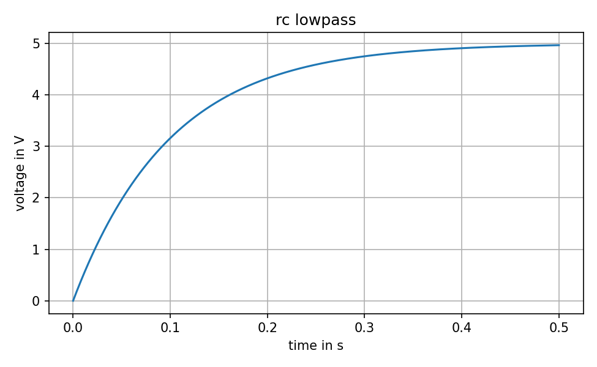{fig-align="center"}


### 2. RL-Schaltung — 24-V-Versorgungssprung

**Physikalischer Hintergrund.** Eine Induktivität
$L = 0.1\,\mathrm{H}$ in Reihe mit einem Widerstand
$R = 10\,\mathrm{\Omega}$ an einem 24-V-Industrie-Netzteil (z. B. eine
Relais- oder Schützspule, die eingeschaltet wird). Der Strom durch eine
Induktivität kann nicht springen.

$$G(s) = \frac{U/R}{\frac{L}{R}s + 1} = \frac{2.4}{0.01\,s + 1}, \qquad
y(t) = 2.4\left(1 - e^{-100t}\right)\,\mathrm{A}$$

Zeitkonstante $\tau = L/R = 0.01\,\mathrm{s}$ — zehnmal schneller als
der RC-Tiefpass. Der Strom stellt sich auf $I_\infty = U/R =
2.4\,\mathrm{A}$ ein.

**CSV:** `csv/02.csv` (0 … 0.05 s)

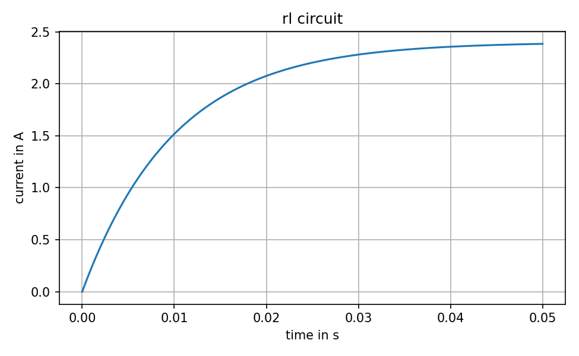{fig-align="center"}

### 3. Masse-Feder-Dämpfer — 50-N-Kraftsprung

**Physikalischer Hintergrund.** Eine Masse $m = 2\,\mathrm{kg}$ auf
einer Feder $k = 2000\,\mathrm{N/m}$ mit einem Dämpfer
$d = 20\,\mathrm{N\,s/m}$, z. B. ein kleines Maschinenteil auf einer
weichen Lagerung. Ein Kraftsprung von $F = 50\,\mathrm{N}$ (eine
plötzliche Last) lenkt die Feder auf die statische Auslenkung
$x_\infty = F/k = 2.5\,\mathrm{cm}$ aus.

$$G(s) = \frac{F}{m s^2 + d s + k} = \frac{50}{2s^2 + 20s + 2000}$$

Mit $\omega_n = \sqrt{k/m} \approx 31.6\,\mathrm{rad/s}$ und
$\zeta = d/(2\sqrt{km}) \approx 0.16 < 1$ ist das System
**unterdämpft**: die Position überschwingt die 2.5-cm-Marke deutlich
und schwingt mit $\omega_d \approx 31.2\,\mathrm{rad/s}$
($\approx 5\,\mathrm{Hz}$) nach, bevor sie sich einschwingt.

**CSV:** `csv/03.csv` (0 … 0.5 s)

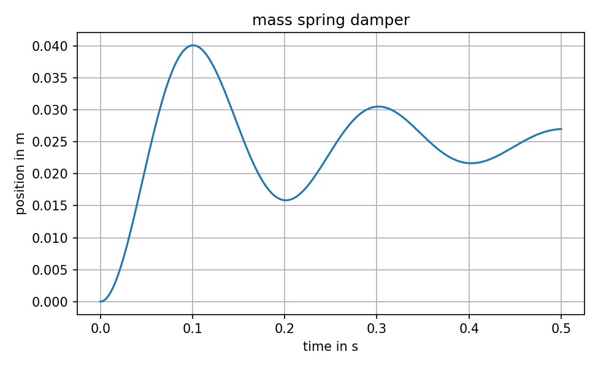{fig-align="center"}

### 4. DC-Motor — 12-V-Batteriesprung

**Physikalischer Hintergrund.** Ein DC-Motor mit Trägheit
$J = 0.02\,\mathrm{kg\,m^2}$, viskoser Reibung
$b = 0.2\,\mathrm{N\,m\,s/rad}$, Ankerwiderstand
$R = 1\,\mathrm{\Omega}$ und Ankerinduktivität
$L = 0.05\,\mathrm{H}$, Drehmomentkonstante
$K_m = 0.05\,\mathrm{N\,m/A}$ und Gegen-EMK-Konstante
$K_e = 0.05\,\mathrm{V\,s/rad}$, an einer 12-V-Batterie. Das
Motormoment beschleunigt die Trägheit; die Gegen-EMK koppelt die
Drehzahl zurück in den elektrischen Kreis — daraus ergibt sich eine
Übertragungsfunktion zweiter Ordnung:

$$G(s) = \frac{U K_m}{(Js + b)(Ls + R) + K_m K_e}
      = \frac{0.6}{0.001 s^2 + 0.03 s + 0.2025}$$

Beide Pole sind reell und negativ ($\approx -10.3$ und $-19.7$), der
Motor läuft also ohne Überschwingen auf
$\omega_\infty \approx 2.96\,\mathrm{rad/s} \approx
28\,\mathrm{rpm}$ hoch.

**CSV:** `csv/04.csv` (0 … 1.5 s)

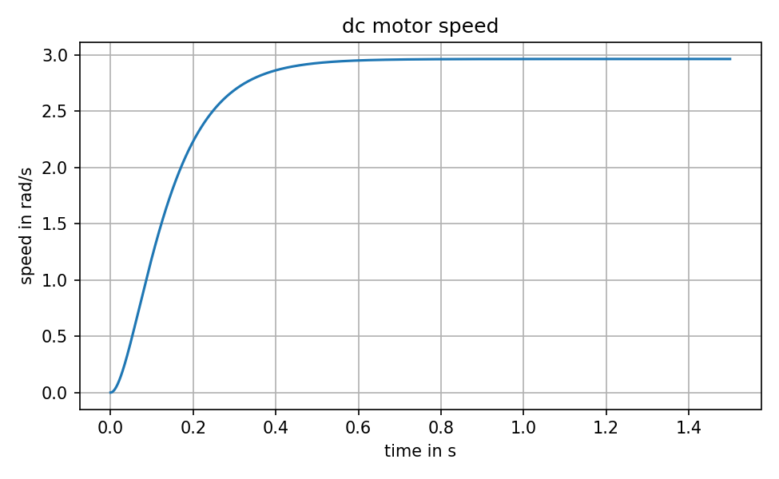{fig-align="center"}

### 5. Thermischer Prozess — 500-W-Heizleistungssprung

**Physikalischer Hintergrund.** Ein elektrisches Heizelement
($P = 500\,\mathrm{W}$), das einen Körper erwärmt, lässt sich als zwei
in Reihe geschaltete Energiespeicher modellieren: die Heizung selbst
(schnell, $\tau_1 = 5\,\mathrm{s}$) und die erwärmte Masse mit ihrer
Wärmekapazität und ihrem Wärmeverlust an die Umgebung (langsam,
$\tau_2 = 60\,\mathrm{s}$). Die Gesamtverstärkung ist
$K = 4\,\mathrm{K/kW}$.

$$G(s) = \frac{K P}{(\tau_1 s + 1)(\tau_2 s + 1)}
      = \frac{2}{(5s + 1)(60s + 1)}$$

Zwei reelle Pole in Reihe (PT2). Die Antwort ist s-förmig — flach am
Anfang (Wendepunkt), typisch für thermische Prozesse — und der Körper
erwärmt sich um $+2\,\mathrm{K}$.

**CSV:** `csv/05.csv` (0 … 250 s)

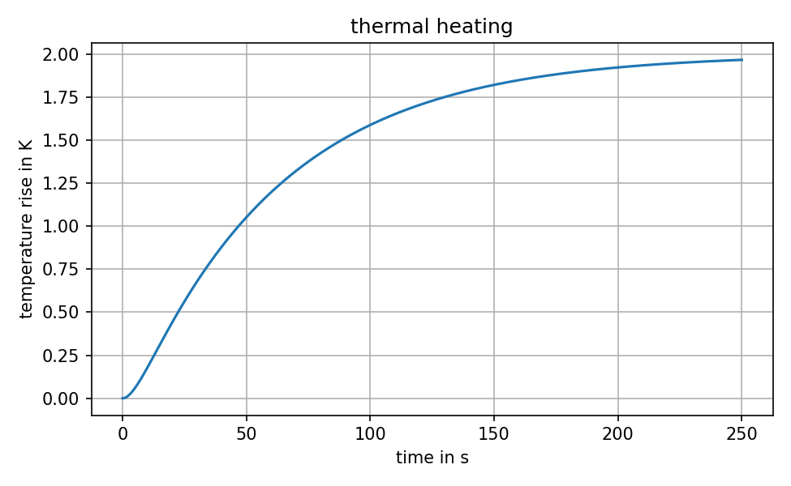{fig-align="center"}

### Zusammenfassung von Teil I

| System | Eingangssprung | Ausgang | Ordnung | Pole | Endwert | Charakter |
|---|---|---|---|---|---|---|
| RC-Tiefpass | 5 V | 0 → 5 V | 1 | $-10$ | 5 V | PT1 |
| RL-Schaltung | 24 V | 0 → 2.4 A | 1 | $-100$ | 2.4 A | PT1 (schnell) |
| Masse-Feder-Dämpfer | 50 N | 0 → 2.5 cm | 2 | $-5 \pm j\,31.2$ | 2.5 cm | unterdämpft |
| DC-Motordrehzahl | 12 V | 0 → 2.96 rad/s | 2 | $\approx -10.3,\ -19.7$ | 2.96 rad/s | überdämpftes PT2 |
| Thermische Heizung | 500 W | 0 → +2 K | 2 | $-0.2,\ -0.0167$ | 2 K | PT2, s-förmig |

## Teil II — Fünf Anwendungen und der RLC-Reihenkreis

### 6. Tempomat — Antriebskraft auf Geschwindigkeit

**Physikalischer Hintergrund.** Ein 1,4-t-PKW
($m = 1400\,\mathrm{kg}$) wird durch eine konstante Antriebskraft von
$F = 500\,\mathrm{N}$ beschleunigt, während ein linearisierter
Fahrwiderstand (Luft + Rollreibung) von
$c = 25\,\mathrm{N\,s/m}$ der Bewegung entgegenwirkt. Das
Newton-Gesetz liefert $m\dot v + c v = F$.

$$G(s) = \frac{F}{m s + c} = \frac{500}{1400 s + 25}, \qquad
y(t) = 20\left(1 - e^{-t/56}\right)\,\mathrm{m/s}$$

Zeitkonstante $\tau = m/c = 56\,\mathrm{s}$. Der PKW erreicht
asymptotisch $v_\infty = F/c = 20\,\mathrm{m/s}$
($\approx 72\,\mathrm{km/h}$) — genau die Strecke, gegen die ein
Tempomat auf ebener Straße arbeiten muss.

**CSV:** `csv/06.csv` (0 … 200 s)

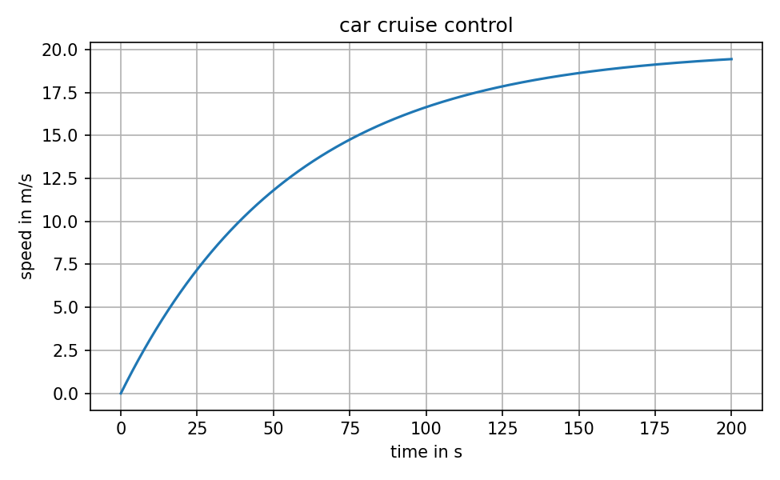{fig-align="center"}

### 7. Wasserbeckenfüllstand — Pumpenzufluss auf Füllstand

**Physikalischer Hintergrund.** Ein Prozessbehälter mit Querschnitt
$A = 0.5\,\mathrm{m^2}$ wird von einer Pumpe mit einem Zuflusssprung
von $q = 2\,\mathrm{L/s}$ gespeist. Das um den Arbeitspunkt
linearisierte Ablaufventil hat den Leitwertswiderstand
$R = 40\,\mathrm{s/m^2}$, der Abfluss ist also $q_{out} = h/R$.
Massenbilanz: $A\,\dot h = q_{in} - h/R$.

$$G(s) = \frac{q R}{A R s + 1} = \frac{0.08}{20 s + 1}, \qquad
y(t) = 0.08\left(1 - e^{-t/20}\right)\,\mathrm{m}$$

Zeitkonstante $\tau = A R = 20\,\mathrm{s}$. Der Füllstand stellt
sich auf $h_\infty = q R = 8\,\mathrm{cm}$ ein — ein klassisches PT1
der Verfahrenstechnik.

**CSV:** `csv/07.csv` (0 … 100 s)

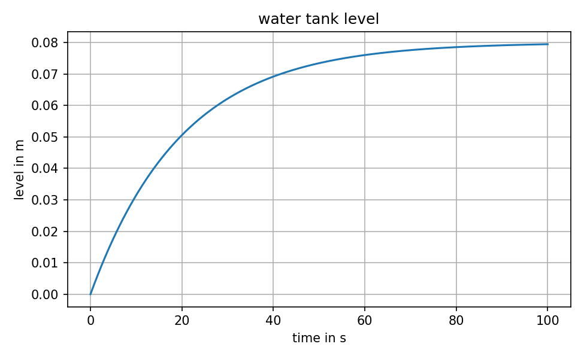{fig-align="center"}

### 8. Synchroner Tiefsetzsteller (Buck) — Tastverhältnis auf Ausgangsspannung

**Physikalischer Hintergrund.** Ein 12-V-auf-Niederspannung-Buck-Wandler
mit LC-Ausgangsfilter ($L = 47\,\mathrm{\mu H}$,
$C = 220\,\mathrm{\mu F}$) an einer $1\,\mathrm{\Omega}$-Last. Ein
Tastverhältnissprung von $\Delta d = 0.1$ verschiebt die mittlere
Ausgangsspannung um $\Delta V = V_{in}\,\Delta d = 1.2\,\mathrm{V}$.

$$G(s) = \frac{V_{in}\,\Delta d}{LC\,s^2 + \frac{L}{R} s + 1}
      = \frac{1.2}{1.034\cdot10^{-8}\,s^2 + 4.7\cdot10^{-5}\,s + 1}$$

Eigenfrequenz $\omega_n = 1/\sqrt{LC} \approx 9.83\cdot
10^3\,\mathrm{rad/s}$ ($\approx 1.56\,\mathrm{kHz}$); die gedämpfte Eigenfrequenz
ist $\omega_d \approx 9.57\cdot10^3\,\mathrm{rad/s}$. Dämpfungsgrad
$\zeta = \tfrac{1}{2R}\sqrt{L/C} \approx 0.23$: die Ausgangsspannung
schwingt nach und überschwingt, bevor sie sich innerhalb weniger
Millisekunden auf 1.2 V einstellt. Solch schnelle Übergangsvorgänge
sind der Grund, warum Schaltnetzteile eine sorgfältige
Regelkreis-Auslegung brauchen.

**CSV:** `csv/08.csv` (0 … 5 ms)

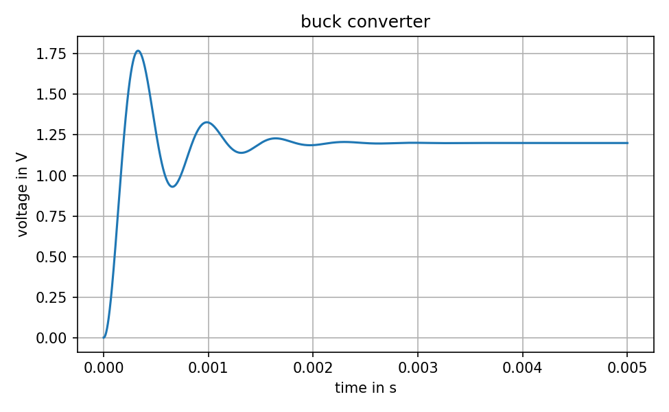{fig-align="center"}

### 9. Schiffs-Autopilot — Ruder auf Kurs (Nomoto-Modell)

**Physikalischer Hintergrund.** Das Nomoto-Modell erster Ordnung ist
die Standard-Niederfrequenznäherung der Gierdynamik von Schiffen. Für
ein Frachtschiff mit Ruderwinkelverstärkung
$K = 0.05\,(\mathrm{deg/s})/\mathrm{deg}$ und Zeitkonstante
$T = 20\,\mathrm{s}$ dreht ein Rudersprung von
$\delta = 10\,\mathrm{deg}$ das Schiff.

$$G(s) = \frac{K\,\delta}{s\,(T s + 1)} = \frac{0.5}{s\,(20 s + 1)},
\qquad y(t) = 0.5\,t - 10\left(1 - e^{-t/20}\right)\,\mathrm{deg}$$

Der Integrierer ($1/s$) ist wesentlich: Der Kurs ist das Integral der
Drehrate, die Sprungantwort ist also keine einschwingende Kurve,
sondern eine Rampe. Nach dem Übergangsvorgang ($t \gg T$) dreht das
Schiff mit konstanten $0.5\,\mathrm{deg/s}$; bei $t = 200\,\mathrm{s}$
beträgt der Kurs $\approx 90\,\mathrm{deg}$ — das Schiff kreist, und
genau dieses (stabile, aber nicht einschwingende) offene Verhalten
schließt ein Autopilot zum Regelkreis.

**CSV:** `csv/09.csv` (0 … 200 s)

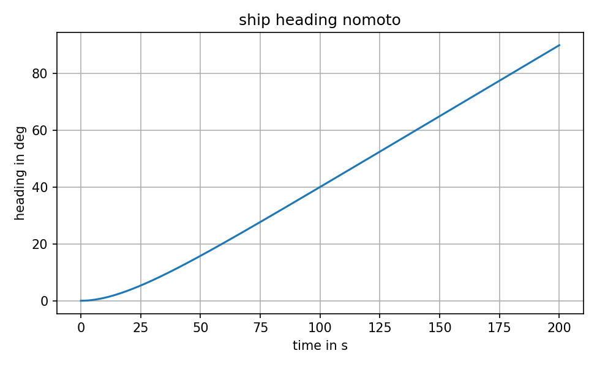{fig-align="center"}

### 10. Raumluftanlage mit Kanaltotzeit — Heizleistung auf Raumtemperatur

**Physikalischer Hintergrund.** Eine Heizung gibt einen
Leistungssprung von $P = 1\,\mathrm{kW}$ in einen Lüftungskanal ab.
Die warme Luft braucht $L = 8\,\mathrm{s}$ von der Heizung in den Raum,
und der Raum selbst ist ein PT1 mit Verstärkung
$K = 2.5\,\mathrm{K/kW}$ und Zeitkonstante
$\tau = 120\,\mathrm{s}$ (Wärmekapazität von Luft + Wänden,
Wärmeverlust an die Umgebung).

$$G(s) = \frac{K\,P\,e^{-L s}}{\tau s + 1}
      = \frac{2.5\,e^{-8 s}}{120 s + 1}$$

$$y(t) = 2.5\left(1 - e^{-(t-8)/120}\right)\sigma(t - 8)\,\mathrm{K}$$

Die Antwort ist die ersten 8 s exakt null (vor dem Transportweg kommt
nichts an) und steigt danach exponentiell gegen $+2.5\,\mathrm{K}$.
Totzeit ist der Hauptgrund, warum Raumluftkreise nicht aggressiv
geregelt werden können: der Regler sieht 8 s lang keine Reaktion auf
seine Stellgröße.

**CSV:** `csv/10.csv` (0 … 400 s)

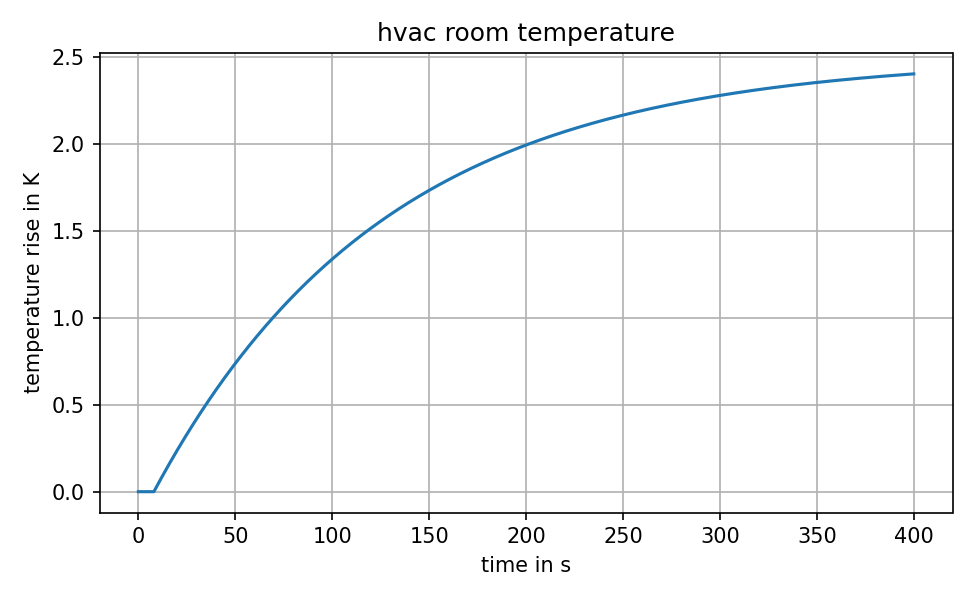{fig-align="center"}

### 11. RLC-Reihenkreis — 12-V-Sprung

**Physikalischer Hintergrund.** Ein RLC-Reihenkreis mit
$R = 5\,\mathrm{\Omega}$, $L = 1\,\mathrm{mH}$ und
$C = 10\,\mathrm{\mu F}$, z. B. das Ausgangsfilter einer
Leistungselektronik-Stufe, angeregt durch einen 12-V-Versorgungssprung.
Der Ausgang ist die Kondensatorspannung: die Induktivität speichert
magnetische Energie und tauscht sie mit dem Kondensator aus, deshalb
schwingt die Spannung ein, bevor sie sich einschwingt.

$$G(s) = \frac{U}{LC\,s^2 + RC\,s + 1}
      = \frac{12}{10^{-8}\,s^2 + 5\cdot10^{-5}\,s + 1}$$

$$y(t) = 12\left(1 - e^{-2500t}\left(\cos(9682\,t) +
 0.258\,\sin(9682\,t)\right)\right)\,\mathrm{V}$$

Eigenfrequenz $\omega_n = 1/\sqrt{LC} = 10^4\,\mathrm{rad/s}$
($\approx 1.6\,\mathrm{kHz}$) mit Dämpfungsgrad
$\zeta = \tfrac{R}{2}\sqrt{C/L} = 0.25$: klar **unterdämpft**. Die
Kondensatorspannung überschwingt die 12-V-Marke um etwa 44 % auf
$\approx 17.3\,\mathrm{V}$ und schwingt mit
$\omega_d \approx 9682\,\mathrm{rad/s}$ bei einer Abklingzeitkonstante
von $2L/R = 0.4\,\mathrm{ms}$ ein; nach etwa 2 ms stellt sie sich auf
12 V — dasselbe Nachschwingen wie beim LC-Filter des Tiefsetzstellers
(System 8).

**CSV:** `csv/11.csv` (0 … 2 ms)

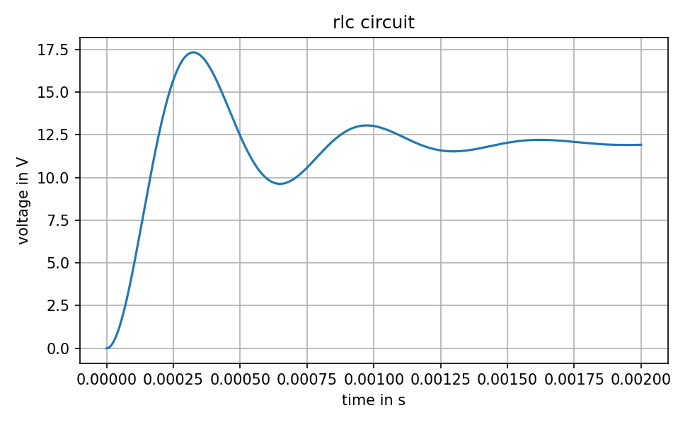{fig-align="center"}

### Zusammenfassung von Teil II

| Anwendung | Eingangssprung | Ausgang | Ordnung | Pole | Charakter |
|---|---|---|---|---|---|
| Tempomat | 500 N Antriebskraft | Geschwindigkeit (m/s) | 1 | $-1/56$ | PT1, $\tau = 56$ s |
| Wasserbecken | 2 L/s Zufluss | Füllstand (m) | 1 | $-1/20$ | PT1, $\tau = 20$ s |
| Tiefsetzsteller | $\Delta d = 0.1$ | Spannung (V) | 2 | $-2273 \pm j\,9568$ | unterdämpft, $\zeta = 0.23$ |
| Schiffskurs (Nomoto) | $10^\circ$ Ruder | Kurs (deg) | 2 | $0,\ -1/20$ | integrierend (Rampe) |
| Raumluftanlage | 1 kW Heizleistung | Temperatur (K) | 1 + Totzeit | $-1/120$, $e^{-8s}$ | PT1 + 8 s Totzeit |
| RLC-Reihenkreis | 12 V | Spannung (V) | 2 | $-2500 \pm j\,9682$ | unterdämpft, $\zeta = 0.25$ |

Im Vergleich zu Teil I zeigen die Anwendungen Effekte, die in der
Praxis zählen: sehr unterschiedliche Zeitskalen (ms bis Minuten), das
Nachschwingen eines leistungselektronischen Wandlers, ein Integrierer
im Schiffsmodell und reine Transporttotzeit in der Raumluftanlage.

## Teil III — Die 1-kΩ-Varianten

Drei Systeme werden zusätzlich mit demselben Widerstandswert
$R = 1\,\mathrm{k\Omega}$ erzeugt (`01_a`, `02_a`, `11_b`, Skript
`generate_step_responses_1k_variants.py`). Die Originale bleiben
unverändert.

### 01_a — RC-Tiefpass mit R = 1 kΩ

Identisch zu System 1: Der RC-Tiefpass verwendet bereits
$R = 1\,\mathrm{k\Omega}$ mit $C = 100\,\mathrm{\mu F}$, die
Sprungantwort ist also dieselbe Kurve — $\tau = RC = 0.1\,\mathrm{s}$,
0 V auf 5 V.

**CSV:** `csv/01_a.csv` (0 … 0.5 s)

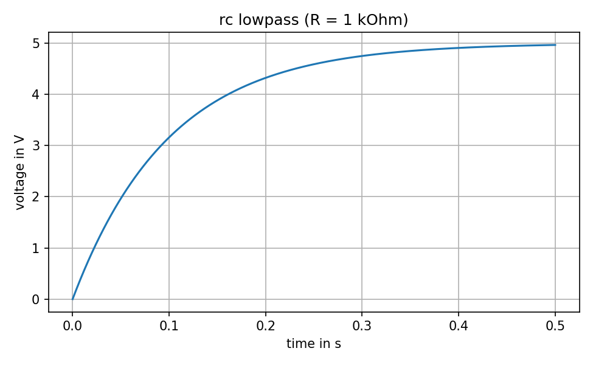{fig-align="center"}

### 02_a — RL-Schaltung mit R = 1 kΩ

Mit $R = 1\,\mathrm{k\Omega}$ statt $10\,\mathrm{\Omega}$ fällt der
Endstrom auf $U/R = 24\,\mathrm{mA}$, und die Zeitkonstante schrumpft
hundertfach auf $\tau = L/R = 0.1\,\mathrm{ms}$: der Strom steigt
100-mal schneller an, aber nur auf ein Hundertstel der ursprünglichen
2.4 A.

$$G(s) = \frac{0.024}{10^{-4}\,s + 1}$$

**CSV:** `csv/02_a.csv` (0 … 0.5 ms)

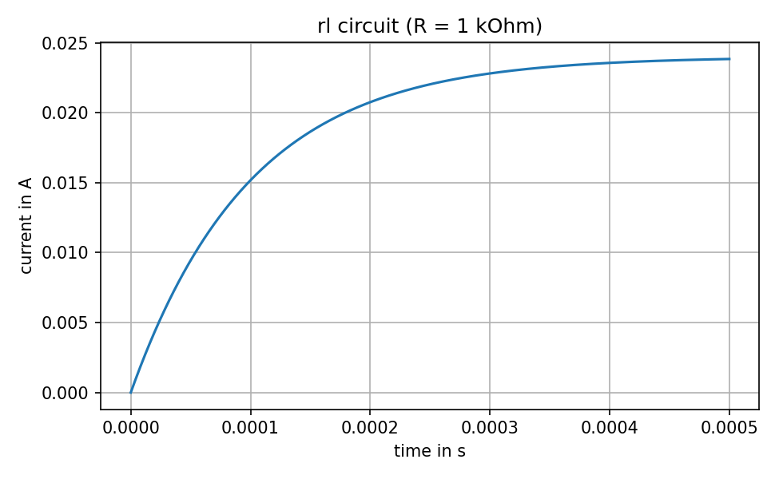{fig-align="center"}

### 11_b — RLC-Reihenkreis mit R = 1 kΩ

Der lehrreichste der drei: Das Anheben von $R$ von
$5\,\mathrm{\Omega}$ auf $1\,\mathrm{k\Omega}$ verschiebt die Dämpfung
von $\zeta = 0.25$ auf $\zeta = 50$ — das Nachschwingen von System 11
verschwindet vollständig. Der Kreis ist stark überdämpft, mit Polen bei
$\approx -100$ und $\approx -10^6\,\mathrm{rad/s}$; die Antwort wird
vom langsamen Pol dominiert: ein träge exponentieller Anstieg auf 12 V
mit $\tau \approx 10\,\mathrm{ms}$ — langsamer als der ursprüngliche
RLC-Kreis, obwohl $L$ und $C$ gleich bleiben.

**CSV:** `csv/11_b.csv` (0 … 50 ms)

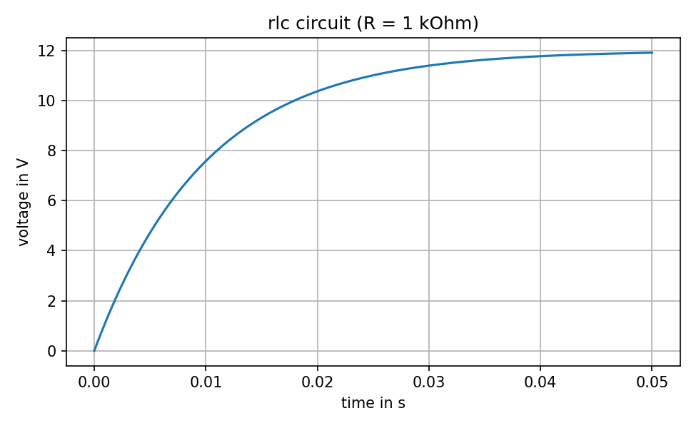{fig-align="center"}

## Teil IV — Fünf Systeme mit kombinierten Effekten

Jedes System in Teil I und II zeigt einen dominanten Effekt. Die fünf
Systeme dieses Teils sind reale technische Anwendungen, in denen
mehrere Effekte **gleichzeitig** wirken: eine rechtsseitige
Nullstelle über einem Filter zweiter Ordnung (Hochsetzsteller), ein
Integrierer hinter einer Transporttotzeit (Banddosierung), eine
differenzierende Nullstelle über einem schwingfähigen PT2
(Motorlager), eine doppelte Verzögerung mit Totzeit (Fernwärme) und
Coulomb-Reibung über einem schwingfähigen PT2 (Maschinenschlitten).
Sie werden von `generate_step_responses_multi_effect.py` erzeugt.

### 12. Hochsetzsteller (12 V auf 24 V) — Tastverhältnis auf Ausgangsspannung

**Physikalischer Hintergrund.** Ein Boost-Wandler, der eine
24-V-Schiene aus einer 12-V-Quelle regelt (z. B. ein
batteriebetriebener LED-Treiber), mit Filterinduktivität
$L = 100\,\mathrm{\mu H}$, Ausgangskondensator
$C = 100\,\mathrm{\mu F}$ und Last
$R = 2\,\mathrm{\Omega}$ ($\approx 12\,\mathrm{A}$). Im Arbeitspunkt
$D = 0.5$ hebt ein Tastverhältnissprung von $\Delta d = 0.02$ die
mittlere Ausgangsspannung um
$\Delta V = V/(1-D)\cdot\Delta d = 0.96\,\mathrm{V}$.

$$G(s) = \frac{(1-D)\,V\,\left(1 - \frac{s\,L}{(1-D)^2 R}\right)}
{LC\,s^2 + \frac{L}{R}s + (1-D)^2}
      = \frac{0.24 - 4.8\cdot10^{-5}\,s}
{10^{-8}\,s^2 + 5\cdot10^{-5}\,s + 0.25}$$

Der Nenner liefert Pole bei $-2500 \pm j\,4330\,\mathrm{rad/s}$
($\omega_n = 5000\,\mathrm{rad/s}$, $\zeta = 0.5$) — aber die
Nullstelle des Zählers liegt in der **rechten s-Halbebene**, bei
$+5000\,\mathrm{rad/s}$ ($= (1-D)^2 R/L$).

$$y(t) = 0.96 - e^{-2500\,t}\left(0.96\,\cos(4330\,t) +
 1.663\,\sin(4330\,t)\right)\,\mathrm{V}$$

Die Sprungantwort ist eine **inverse Antwort**: Der Ausgang bewegt
sich zuerst in die *falsche* Richtung und fällt auf
$-0.27\,\mathrm{V}$ ab, bevor er umkehrt, auf $+1.16\,\mathrm{V}$
überschwingt und sich auf $0.96\,\mathrm{V}$ einstellt. Die Physik
hinter dem Einbruch: Ein erhöhtes Tastverhältnis verkürzt das
Dioden-Leitintervall, der an die Last gelieferte Strom sinkt
*sofort* und der Kondensator entlädt sich; erst danach baut sich der
Induktivitätsstrom auf und lädt den Kondensator wieder auf. Die
nichtminimalphasige Nullstelle ist der Grund, warum ein
Hochsetzsteller grundsätzlich schwerer zu regeln ist als der
Tiefsetzsteller von System 8 — kein Regler kann den anfänglichen
Einbruch aufheben, und die RHP-Nullstelle begrenzt die erreichbare
Bandbreite.

**CSV:** `csv/12.csv` (0 … 3 ms)

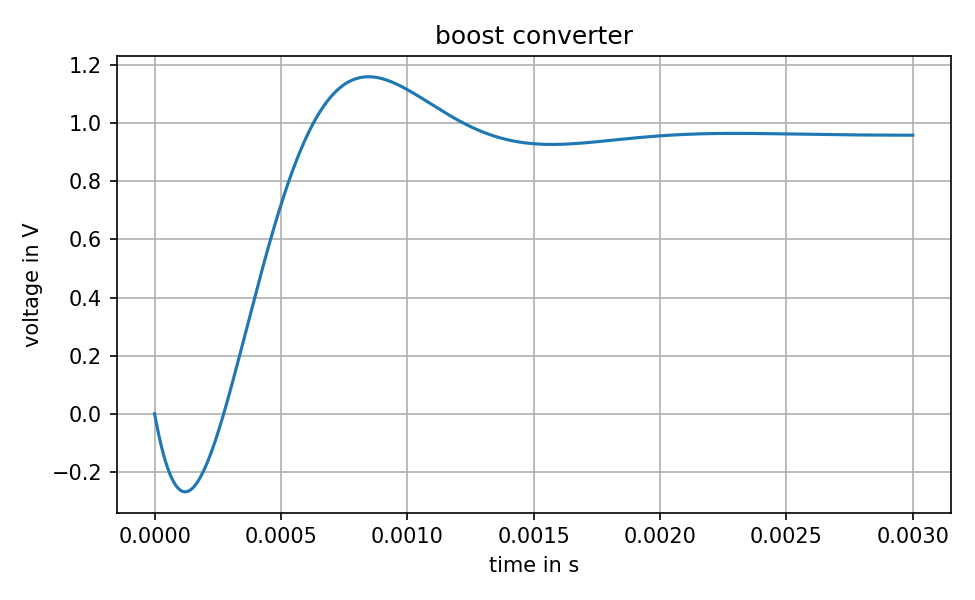{fig-align="center"}

### 13. Förderband-Dosierung — Zuteiler-Massenstrom auf Silomasse

**Physikalischer Hintergrund.** In einer Asphalt- oder
Betonmischanlage fördert eine Schnecke Sand mit
$q = 2\,\mathrm{kg/s}$ auf ein Förderband. Das Material braucht
$L = 30\,\mathrm{m}/2\,\mathrm{m/s} = 15\,\mathrm{s}$ über das Band,
bevor es in das Wiegesilo fällt, dessen Inhalt das Integral des
ankommenden Stroms ist.

$$G(s) = \frac{q\,e^{-L s}}{s} = \frac{2\,e^{-15s}}{s}, \qquad
y(t) = 2\,(t - 15)\,\sigma(t - 15)\,\mathrm{kg}$$

Zwei Effekte multiplizieren sich: der **Integrierer** (das Silo
summiert alles, was ankommt) und die **Transporttotzeit** (15 s lang
kommt nichts an). Die Antwort ist exakt 15 s lang null und danach eine
gerade Rampe von $2\,\mathrm{kg/s}$ — bei $t = 60\,\mathrm{s}$ sind
90 kg angekommen. Das kombiniert den Charakter von System 9
(Integrierer → Rampe) mit dem von System 10 (Totzeit → erst Stille).
In der Dosierpraxis ist die Totzeit das dominante Problem: Um eine
Zielmasse zu erreichen, muss die Zuteilung 15 s früher abgeschaltet
werden, und jeder Fehler, der während der Totzeit passiert, kann erst
korrigiert werden, wenn das Material ankommt.

**CSV:** `csv/13.csv` (0 … 60 s)

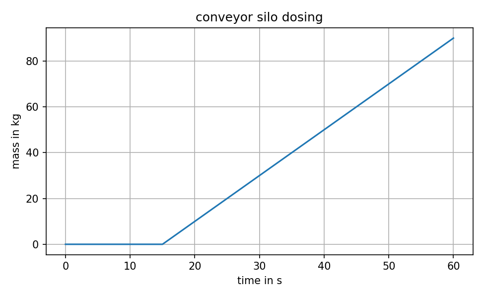{fig-align="center"}

### 14. Gummi-Motorlager — eingeleitete Kraft auf übertragene Kraft

**Physikalischer Hintergrund.** Ein 300-kg-Verbrennungsmotor ruht auf
drei Gummilagern; ein Lager trägt $m = 100\,\mathrm{kg}$ Motormasse
mit einer Steifigkeit von $k = 10^5\,\mathrm{N/m}$ (etwa $9{,}8\,\mathrm{mm}$
statische Einfederung durch die Eigenmasse) und einer Dämpfung von
$d = 630\,\mathrm{N\,s/m}$ ($\zeta \approx 0.1$). Beim Motorstart
trifft eine Drehmoment-Stützkraft von $F = 800\,\mathrm{N}$ auf das
Lager. Interessant ist die Kraft, die das Lager an den Rahmen
weiterleitet: $f_T = k\,x + d\,\dot x$.

$$G(s) = \frac{k + d\,s}{m\,s^2 + d\,s + k}
      = \frac{800(k + d\,s)}{m\,s^2 + d\,s + k}
      = \frac{8\cdot10^7 + 504000\,s}{100\,s^2 + 630\,s + 10^5}$$

Pole bei $-3.15 \pm j\,31.5\,\mathrm{rad/s}$
($\omega_n = 31.6\,\mathrm{rad/s} \approx 5\,\mathrm{Hz}$) und eine
**differenzierende Nullstelle** bei $-k/d = -159\,\mathrm{rad/s}$ —
der Dämpferanteil $d\,\dot x$ in der übertragenen Kraft.

$$y(t) = 800 + e^{-3.15\,t}\left(80.1\,\sin(31.47\,t) -
 800\,\cos(31.47\,t)\right)\,\mathrm{N}$$

Die übertragene Kraft steigt mit der Anfangssteigung
$d\,F/m = 5040\,\mathrm{N/s}$ — eine Feder allein würde im ersten
Augenblick nichts übertragen; die differenzierende Wirkung des
Dämpfers leitet den Stoß sofort weiter. Die Kraft überschwingt den
800-N-Sprung um 75 % auf $1396\,\mathrm{N}$, schwingt mit 5 Hz nach
und stellt sich exakt auf $800\,\mathrm{N}$ ein: Ein Gummi-Lager
überträgt statische Kraft vollständig — Schwingungsisolation wirkt
nur *oberhalb* der Resonanz. Dies ist dieselbe $k$-$d$-$m$-Struktur
wie in System 3, nur mit der zusätzlichen Nullstelle, die daraus
entsteht, dass statt der Position die Kraft gemessen wird.

**CSV:** `csv/14.csv` (0 … 1.5 s)

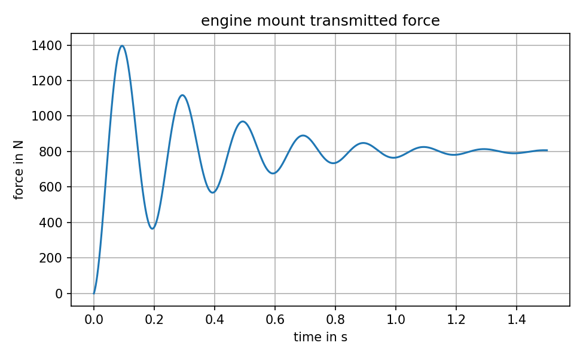{fig-align="center"}

### 15. Fernwärme-Abnehmer — Vorlauftemperatur auf Raumtemperatur

**Physikalischer Hintergrund.** Ein Fernwärmewerk erhöht seine
Vorlauftemperatur um einen Sprung von $6\,\mathrm{K}$. Die
Übergabestation des Abnehmers ist über eine 600-m-Netzleitung mit
Wasser bei $2\,\mathrm{m/s}$ angeschlossen, der Sprung kommt also nach
$L = 300\,\mathrm{s}$ Totzeit an. Hinter der Totzeit folgen zwei
Energiespeicher in Reihe: die Rohrwand mit dem Wärmetauscher
($\tau_1 = 40\,\mathrm{s}$) und das Gebäude mit Heizkörpern und
Wärmemasse ($\tau_2 = 300\,\mathrm{s}$). Verteilverluste ergeben eine
Gesamtverstärkung von $K = 0.9$, der Raum stellt sich also um
$+5.4\,\mathrm{K}$ wärmer ein.

$$G(s) = \frac{K\,\Delta T\,e^{-L s}}{(\tau_1 s + 1)(\tau_2 s + 1)}
      = \frac{5.4\,e^{-300 s}}{(40 s + 1)(300 s + 1)}$$

$$y(t) = 5.4\left[1 - 1.154\,e^{-t'/300} + 0.154\,e^{-t'/40}\right]
 \sigma(t - 300)\,\mathrm{K}, \qquad t' = t - 300$$

Fünf volle Minuten passiert gar nichts, dann beginnt der
s-förmige PT2-Anstieg wie in System 5 — Totzeit plus doppelte
Verzögerung in einer Strecke. Diese Kombination (lange Totzeit *und*
zugleich langsame S-Kurve) ist der Grund, warum Fernwärmekreise
konservativ geregelt werden: Ein Regler, der während der 5 stillen
Minuten aggressiv reagiert, überschwingt stark, sobald die Wirkung
endlich eintrifft. Zusammen mit System 10 zeigt dieses System, wie
stark allein die Totzeit die Regelung erschwert.

**CSV:** `csv/15.csv` (0 … 1800 s)

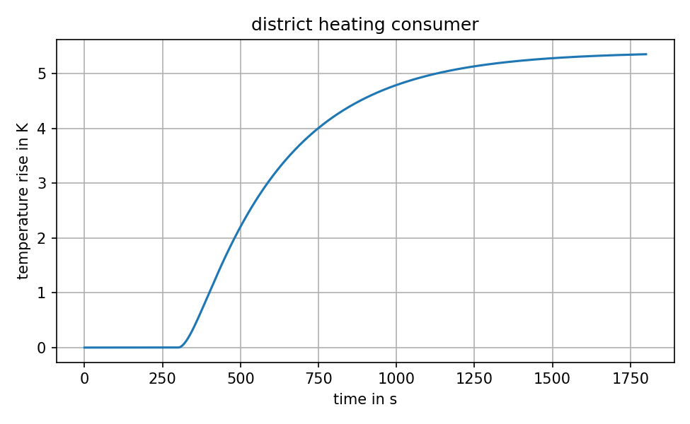{fig-align="center"}

### 16. Maschinenschlitten mit Coulomb-Reibung — Antriebskraft auf Position

**Physikalischer Hintergrund.** Ein $m = 40\,\mathrm{kg}$ schwerer
Tisch eines Maschinenschlittens wird über einen Kugelgewindetrieb
angetrieben, dessen axiale Nachgiebigkeit
$k = 10^6\,\mathrm{N/m}$ beträgt; die Führungen fügen viskose Reibung
$d = 60\,\mathrm{N\,s/m}$ und — entscheidend — Coulomb-Reibung von
$F_c = 60\,\mathrm{N}$ hinzu. Ein Servo-Kraftsprung von
$F = 200\,\mathrm{N}$ wird aufgebracht. Coulomb-Reibung wirkt der
*Bewegungsrichtung* entgegen, $\pm F_c$, das System ist also
nichtlinear und hat keine Übertragungsfunktion — Superposition und der
inverse-Laplace-Weg der anderen Systeme gelten nicht. Die
Bewegungsgleichung (während der Bewegung) ist

$$m\,\ddot x + d\,\dot x + k\,x +
 F_c\,\operatorname{sign}(\dot x) = F,$$

und der Schlitten **klebt dauerhaft fest**, sobald $\dot x = 0$ und
$|F - k x| \le F_c$. Dieses System wird deshalb numerisch integriert
(RK4 mit Stick-Erkennung) in
`generate_step_responses_multi_effect.py` — das einzige
nicht-analytische Beispiel dieses Kapitels.

Die Antwort kombiniert zwei Effekte. Der linearisierte Teil wäre ein
schwingfähiges PT2 ($\omega_0 = \sqrt{k/m} =
158\,\mathrm{rad/s}$, d. h. 25 Hz, $\zeta = 0.005$ — fast ungedämpft).
Die Reibung fügt eine **Totzone** hinzu: Jede stationäre Antriebskraft
unter $F_c = 60\,\mathrm{N}$ erzeugt *gar keine* Bewegung, und der
Schlitten kann überall innerhalb des Reibbandes
$[(F-F_c)/k,\ (F+F_c)/k] = [140, 260]\,\mathrm{\mu m}$ zur Ruhe
kommen. In der Simulation überschwingt der Schlitten auf
$278\,\mathrm{\mu m}$ (gegenüber dem idealen
$F/k = 200\,\mathrm{\mu m}$), schwingt einmal zurück und **klebt
nach etwa 40 ms bei $242\,\mathrm{\mu m}$ fest** — mit den
qualitativen Unterschieden zu jedem linearen System: Das Einschwingen
geschieht in *endlicher* Zeit (kein asymptotischer Schweif, weil die
Reibung pro Halbschwingung einen festen Energiebetrag entfernt), und
die Endposition liegt in einem
$\pm F_c/k = \pm 60\,\mathrm{\mu m}$ breiten Fehlerband, das kein
Proportionalregler schließen kann. Deshalb verwenden Präzisionsmaschinen
vorgespannte, reibungsfreie Führungen, und deshalb verursacht Reibung
Stick-Slip und Grenzzyklen in Positionierkreisen.

**CSV:** `csv/16.csv` (0 … 60 ms)

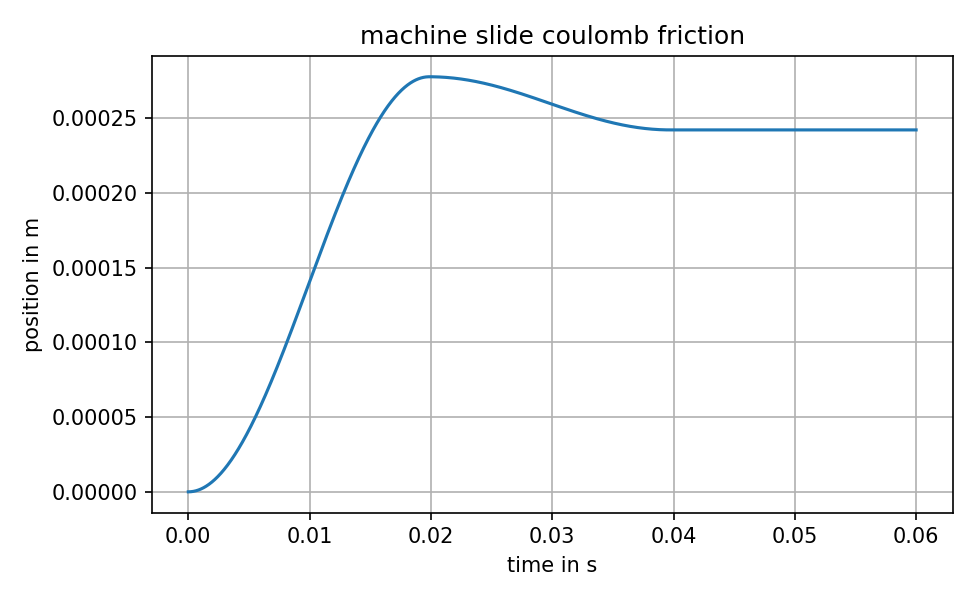{fig-align="center"}

### Zusammenfassung von Teil IV

| System | Eingangssprung | Ausgang | Kombinierte Effekte | Pole / Nullstellen | Charakter |
|---|---|---|---|---|---|
| Hochsetzsteller | $\Delta d = 0.02$ | 0 → 0.96 V | PT2 + RHP-Nullstelle | $-2500 \pm j\,4330$; Nullstelle $+5000$ | inverse Antwort (zuerst Einbruch) |
| Banddosierung | 2 kg/s | 0 → 90 kg (bei 60 s) | Integrierer + Totzeit | $0$; $e^{-15s}$ | 15 s Stille, dann Rampe |
| Motorlager | 800 N | 0 → 800 N | PT2 + differenzierende Nullstelle | $-3.15 \pm j\,31.5$; Nullstelle $-159$ | 75 % Überschwingen, volle statische Übertragung |
| Fernwärme | $+6$ K Vorlauf | 0 → +5.4 K | PT2 + Totzeit | $-1/40,\ -1/300$; $e^{-300s}$ | s-förmig nach 5 min |
| Maschinenschlitten | 200 N | 0 → 242 µm | PT2 + Coulomb-Reibung | $-0.75 \pm j\,158$ (linearisiert) | Totzone, endliches Einschwingen |

Während Teil I und II einzelne Effekte isolieren, zeigt Teil IV, was
geschieht, wenn Effekte zusammenwirken: eine inverse Antwort, die kein
Regler aufheben kann (RHP-Nullstelle), eine Rampe, die erst nach der
Transporttotzeit beginnt, ein Kraftpfad, der durch eine differenzierende
Nullstelle sofort steil ansteigt, eine S-Kurve, die um Minuten verzögert
ist, und eine Totzone, die das glatte asymptotische Einschwingen in ein
endliches Festkleben mit bleibendem Positionsfehler verwandelt.

## Erzeugung der Daten

Verwendet wird die Conda-Umgebung `mtrs_env` (Python 3.9, sympy,
numpy, pandas, matplotlib):

```bash
conda activate mtrs_env
python generate_step_responses.py
python generate_step_responses_applications.py
python generate_step_responses_1k_variants.py
python generate_step_responses_multi_effect.py
```

Die Skripte regenerieren die sechzehn CSV-Dateien (beschreibende Kopien
im Projektordner, kurznummerierte Kopien in `csv/`), eine eigene Grafik
pro System im Ordner `images/sprungantworten/` (die in diesem Kapitel
eingebetteten Abbildungen) sowie die drei 1-kΩ-Varianten (`01_a`,
`02_a`, `11_b`). System 16 wird numerisch integriert (RK4 mit
Stick-Erkennung), weil Coulomb-Reibung keine Übertragungsfunktion
zulässt; die Systeme 1–15 werden mit sympy analytisch invertiert. Die
Skripte gehören zum MTRS-Datenprojekt „Step Response To Transfer
Function“; die kombinierten Übersichtsgrafiken
`step_responses.png`, `step_responses_applications.png` und
`step_responses_multi_effect.png` werden weiterhin geschrieben, in
diesem Kapitel aber nicht verwendet.
